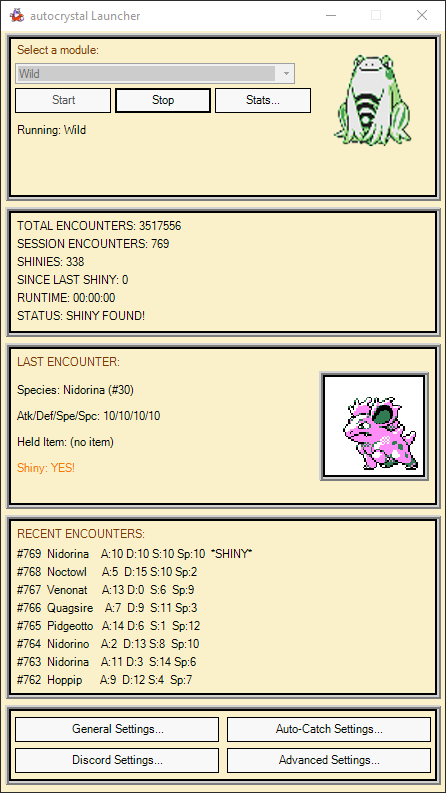
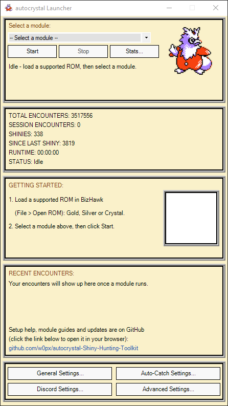
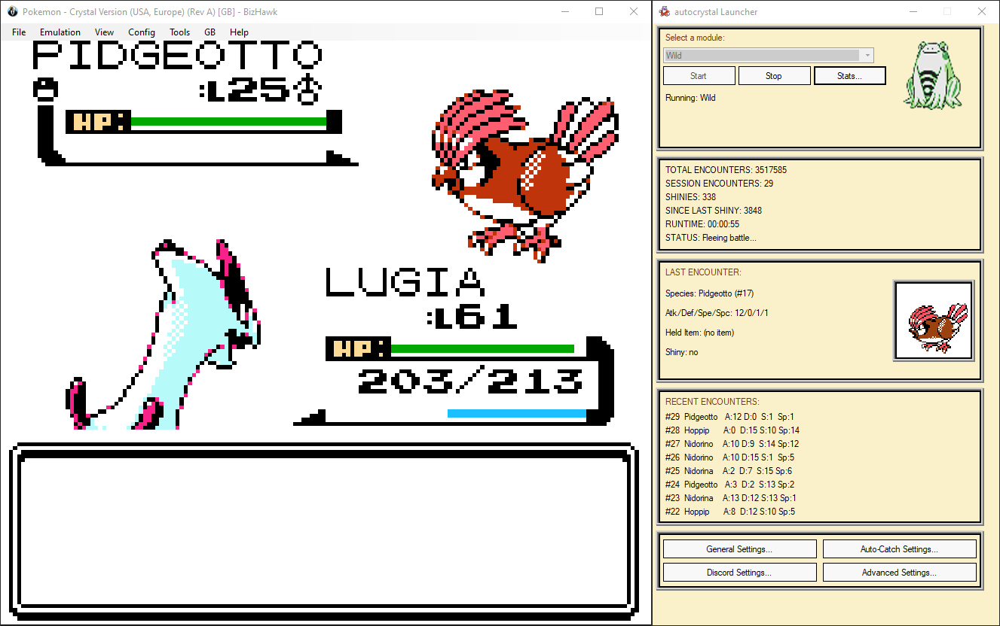
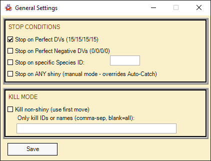
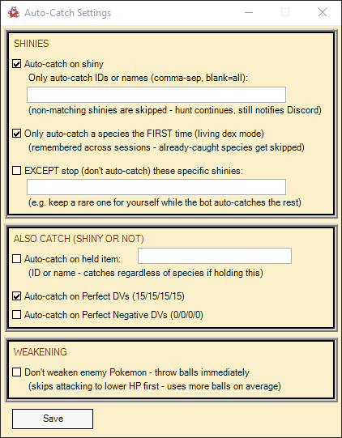
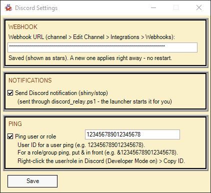
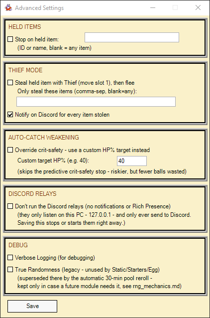
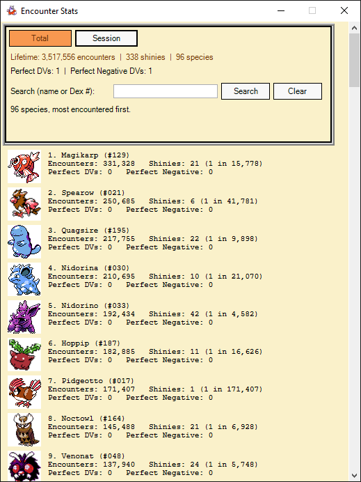
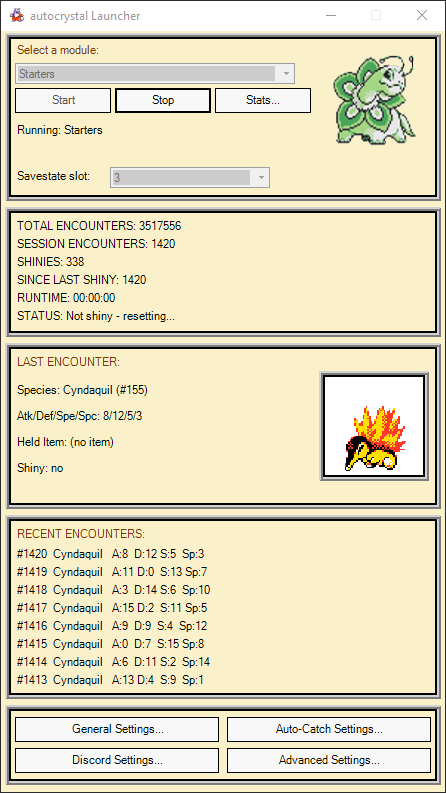
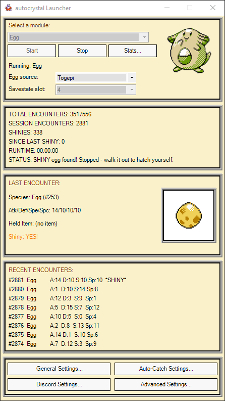

<p align="center">
  
</p>

<h1 align="center">autocrystal</h1>

<p align="center">
  <b>Pokémon G/S/C Automated Shiny & Perfect DV Hunting, Fishing, Headbutt, Egg, Static, Item & Level Grinding Toolkit</b><br>
  <b>API Project:</b> <a href="https://github.com/w0px/w0p-autocrystal">w0p-autocrystal</a><br>
  <b>Discord:</b> w0p
</p>

<p align="center">
  
</p>

## Highlights

- **One click to start** – `start.exe` opens a bundled, ready-to-go **BizHawk 2.11.1** with the launcher already loaded. Nothing else to download, install or configure.
- **BizHawk and the launcher stay together** – they open side by side at the same height and move and resize as one unit.
- **PokéGear-style launcher** – live counters, the last encounter's **animated sprite** (the shiny one for shinies), and your 8 most recent encounters.
- **All options in four settings windows** – General, Auto-Catch, Discord and Advanced, **remembered between sessions**.
- **Encounter Stats window** – lifetime and per-session numbers for every species you've met, with shiny odds and sprites.
- **Discord, set up inside the launcher** – paste your webhook and you're done: shiny/catch/stop notifications with animated sprites, optional pings, and a Rich Presence card on your profile.

## Table of Contents

- [Highlights](#highlights)
- [Functions](#functions)
- [How to Run](#how-to-run)
  - [Requirements](#requirements)
  - [Getting Started](#getting-started)
  - [BizHawk and the Launcher Move as One](#bizhawk-and-the-launcher-move-as-one)
  - [Why BizHawk 2.11.1 Is Bundled](#why-bizhawk-2111-is-bundled)
- [The Launcher](#the-launcher)
  - [General Settings](#general-settings)
  - [Auto-Catch Settings](#auto-catch-settings)
  - [Discord Settings](#discord-settings)
  - [Advanced Settings](#advanced-settings)
  - [Encounter Stats](#encounter-stats)
  - [Sprites](#sprites)
- [Modules](#modules)
  - [Wild Encounters Module](#wild-encounters-module)
  - [Starters Module](#starters-module)
  - [Fishing Module](#fishing-module)
  - [Headbutt Module](#headbutt-module)
  - [Egg Module](#egg-module)
  - [Static Module](#static-module)
  - [Game Corner Module](#game-corner-module)
  - [Friendship Module](#friendship-module)
- [FAQ](#faq)
  - [Supported Versions](#supported-versions)
  - [Transferring Save Files from One Emulator to Another](#transferring-save-files-from-one-emulator-to-another)
  - [Emulator Speed](#emulator-speed)
  - [Discord Notifications](#discord-notifications)
  - [Why Are There Local Relays?](#why-are-there-local-relays)
  - [Savestate Slot Usage](#savestate-slot-usage)
  - [Simulating Randomness: RNG Manipulation in Deterministic Emulation](#simulating-randomness-rng-manipulation-in-deterministic-emulation)
  - [How Headbutt Trees Work in Gen 2](#how-headbutt-trees-work-in-gen-2)
- [Roadmap](#roadmap)


## Functions

### Wild Encounter Module ✅
- Shiny Detection
- Held Item Detection
- Perfect DV Detection
- Perfect Negative DV Detection
- Discord Notifications
- Automatic Level Grinding (Kill Mode)
- Item Stealing (Thief Mode)
- Specific Encounter Hunting
- Stuck Detection & Auto-Recovery
- Auto Catch Shiny / Perfect DV / Held Items

### Starter Module ✅
- Shiny Detection
- Perfect DV Detection
- Perfect Negative DV Detection
- Discord Notifications
- Automatic savestate re-roll for full DV coverage

### Fishing Encounter Module ✅
- Shiny Detection
- Held Item Detection
- Perfect DV Detection
- Perfect Negative DV Detection
- Discord Notifications
- Automatic Level Grinding (Kill Mode)
- Item Stealing (Thief Mode)
- Specific Encounter Hunting
- Stuck Detection & Auto-Recovery
- Auto Catch Shiny / Perfect DV / Held Items

### Static Encounter Module ✅
- Shiny Detection
- Perfect DV Detection
- Perfect Negative DV Detection
- Discord Notifications
- Auto Catch Shiny / Perfect DV
- Built-in targets: Sudowoodo, Eevee, Shuckle, Spearow, Celebi, Lapras, Suicune, Snorlax, or any open-world static

### Headbutt Encounter Module ✅
- Shiny Detection
- Held Item Detection
- Perfect DV Detection
- Perfect Negative DV Detection
- Discord Notifications
- Automatic Level Grinding (Kill Mode)
- Item Stealing (Thief Mode)
- Specific Encounter Hunting
- Stuck Detection & Auto-Recovery
- Auto Catch Shiny / Perfect DV / Held Items

### Egg Module ✅
- Shiny Detection
- Perfect DV Detection
- Perfect Negative DV Detection
- Discord Notifications (with an egg picture)
- Togepi egg or Odd Egg

### Game Corner Module ✅
- Shiny Detection
- Perfect DV Detection
- Perfect Negative DV Detection
- Discord Notifications

### Friendship Module ✅
- Auto Grinds Pokémon Friendship via Walking
- Friendship Tracking
- Discord Notifications once 220 Friendship is reached


## How to Run

### Requirements

- **Windows 10 or 11 (64-bit)**
- The **Microsoft Visual C++ 2015–2022 Redistributable (x64)** – BizHawk needs it, and most PCs already have it. If BizHawk doesn't start, install it from [Microsoft](https://aka.ms/vs/17/release/vc_redist.x64.exe).
- An official, unmodified **US or EU** Pokémon Gold, Silver or Crystal ROM (a dump of your own cartridge)

### Getting Started

1. **Download** the [latest release](https://github.com/w0px/autocrystal-Shiny-Hunting-Toolkit/releases/latest) (`autocrystal-release.zip`) and extract it anywhere (e.g. your Documents folder). Keep everything in it together:

   ```
   autocrystal/
   ├── start.exe       <- double-click this
   ├── autocrystal/    <- the bot: launcher, modules, settings and your stats
   └── BizHawk/        <- BizHawk 2.11.1, already set up
   ```

2. **Double-click `start.exe`.** BizHawk opens with the autocrystal launcher right next to it. BizHawk's Lua Console is minimized to the taskbar – leave it there, it's what runs the bot. The Discord relays start in the background on their own.

   > Windows may show a SmartScreen warning the first time, since `start.exe` isn't code-signed. Click **More info → Run anyway**.

   > Downloaded the repository (**Code → Download ZIP**) instead of a release? It doesn't include BizHawk – see `BizHawk/README.txt` for where to put it.

3. In BizHawk, **File → Open ROM** and pick your Gold, Silver or Crystal ROM. Load your save and walk to where you want to hunt – each module's section below says where to stand.

4. In the launcher, **select a module**, check its settings and click **Start**.

<p align="center">
  
</p>

That's all – no Lua Console, no batch files, no command-line flags. Everything below is optional.

### BizHawk and the Launcher Move as One

<p align="center">
  
</p>

The two windows are docked together:

- **Drag either window** and the other one follows.
- **Resize BizHawk** and the launcher matches its height. When you let go, BizHawk's other side snaps to fit the game picture exactly, so there are no black bars.
- **Opening a ROM** (BizHawk resizes itself to its zoom setting) puts both back to the matched size.
- **Maximize BizHawk** to play full screen; restore it and they dock again.

Prefer placing them yourself? Set `ARRANGE_WINDOWS = false` near the top of the helpers section in `autocrystal/launcher.lua`.

### Why BizHawk 2.11.1 Is Bundled

The bot is tested against exactly this BizHawk version, and its Lua scripting interface has changed between BizHawk releases before. Pinning it means an update can never break your hunt halfway through. BizHawk 2.11.1 doesn't need the internet, never updates itself, and runs on the .NET Framework that ships with Windows 10 and 11 – it can stay as it is.

The bundled `BizHawk` folder is also where your in-game saves (`BizHawk/Gameboy/SaveRAM/`), savestates and BizHawk settings live – back it up along with `autocrystal/`.

<details>
<summary>Using your own BizHawk install instead</summary>

- `start.exe` uses `BizHawk\EmuHawk.exe` next to it if it's there. Remove that folder and it looks for an installed BizHawk instead (or asks you to pick `EmuHawk.exe`) and remembers your choice in `autocrystal/start_settings.txt`.
- To start everything by hand, run BizHawk with the two flags Discord needs, then load the launcher in **Tools → Lua Console → Script → Open Script**:

  ```
  EmuHawk.exe --url_post=http://127.0.0.1:5000/ --url_get=http://127.0.0.1:5000/ --lua="<path>\autocrystal\launcher.lua"
  ```

- Other BizHawk versions may work, but only 2.11.1 is tested.

</details>


# The Launcher

<p align="center">
  
</p>

From top to bottom:

- **Module picker** – choose a module, then **Start** / **Stop**. **Stats...** opens the [Encounter Stats](#encounter-stats) window. Modules that need it show extra pickers here: the **Static target**, the **Egg source** and the **Savestate slot**.
- **Counters** – total (lifetime) encounters, this session's encounters, shinies, encounters since the last shiny, runtime and what the bot is doing right now.
- **Last Encounter** – species, DVs, held item and whether it's shiny, with the Pokémon's animated Crystal sprite (the shiny sprite for a shiny, an egg for an unhatched egg).
- **Recent Encounters** – the last 8, with held items and `*SHINY*` marks.
- **Settings** – four buttons, one per settings window below.

Every settings window works the same way: **Save** applies and remembers your changes (they're still there the next time you start the bot); closing a window with **X** throws them away. Your settings are stored in `autocrystal/modules/data/gui_settings.txt`. Options that don't apply to the running module are greyed out.

## General Settings

<p align="center">
  
</p>

- **Stop Conditions** – stop on Perfect DVs, Perfect Negative DVs, a specific species (name or ID), or on **any** shiny. "Stop on ANY shiny" is the manual mode: it overrides Auto-Catch, so the bot stops and leaves the shiny to you.
- **Kill Mode** – battle non-shinies with the first move instead of running, optionally only specific species. See [Kill Mode](#kill-mode-experimental).

## Auto-Catch Settings

<p align="center">
  
</p>

- **Shinies** – catch shinies automatically, optionally only certain species, only the **first** of each species (living dex mode, remembered across sessions), or with exceptions the bot stops for instead (e.g. keep a rare one for yourself).
- **Also catch (shiny or not)** – Pokémon holding a given item, Perfect DVs (15/15/15/15) or Perfect Negative DVs (0/0/0/0).
- **Weakening** – the bot lowers the target's HP before throwing, with a predictive check so a critical hit can't knock it out. Tick "Don't weaken" to throw balls immediately instead.

## Discord Settings

<p align="center">
  
</p>

- **Webhook** – paste your Discord webhook URL here (it's shown as stars). A new one applies right away, even mid-hunt – no restart. See [Discord Notifications](#discord-notifications).
- **Notifications** – turn the shiny/stop notifications on or off.
- **Ping** – mention a user (their ID) or a role (`&` + the role's ID) with every notification.

## Advanced Settings

<p align="center">
  
</p>

- **Held Items** – stop when a wild Pokémon holds an item (any, or a specific one).
- **Thief Mode** – steal held items with Thief, then flee. See [Thief Mode](#thief-mode).
- **Auto-Catch Weakening** – replace the crit-safety check with your own target HP %: riskier, but fewer balls used.
- **Discord Relays** – don't run the two small local helpers that Discord needs, if you'd rather not have them (no notifications or Rich Presence then). Saving stops or starts them immediately. See [Why Are There Local Relays?](#why-are-there-local-relays)
- **Debug** – Verbose Logging prints every action the bot takes to BizHawk's Lua Console; True Randomness is a legacy option (see [below](#the-true-randomness-checkbox-legacy)).

## Encounter Stats

<p align="center">
  
</p>

Opened with **Stats...** in the launcher. Every species you've encountered, most encountered first:

- **Total** / **Session** tabs – lifetime numbers, or just this session's (with encounters per hour and active hunting time).
- Encounters, shinies and your shiny odds ("1 in …") per species, plus Perfect and Perfect Negative DV counts.
- **Search** by name or Dex number.
- Updates live while the bot runs. Your stats are saved after every encounter and survive restarts.

## Sprites

The sprites aren't part of the download. The first time you open Encounter Stats, click **Download sprites...** – a one-time download of the Gen II Crystal sprites (still and animated, normal and shiny) from PokeAPI's open sprite collection. It also makes the sharper, larger versions the launcher's Last Encounter card plays. Without the sprites, everything works the same, just with text only.

The egg picture comes from `autocrystal/data/sprites/normal/egg.png` – replace it with your own and run `autocrystal/tools/make_egg_sprites.ps1` to rebuild the launcher and Discord versions.


# Modules

## Wild Encounters Module

- Self-correcting movement (auto-detects safe directions)
- RAM-verified menu navigation, self-corrects on dropped inputs
- Automatically handles phone calls and other interruptions (e.g. egg hatching)

### Stop Conditions

Set in [General Settings](#general-settings) and [Advanced Settings](#advanced-settings):

- **Perfect DVs (15/15/15/15)** – Stops when a Pokémon with perfect DVs is encountered
- **Perfect Negative DVs (0/0/0/0)** – Stops when a Pokémon with perfect negative DVs is encountered
- **Specific Species (Name or ID)** – Stops when a specified Pokémon is encountered, whether shiny or non-shiny
- **Held Item (Any or Specific)** – Stops when a Pokémon holding any or a specified item is encountered. If a specific item is set, the bot only stops for that item
- **Shiny Pokémon** – Stops on every shiny, unless [Auto-Catch](#auto-catch-settings) is set to catch it (tick "Stop on ANY shiny" to always stop)

### Kill Mode (experimental)

- Automatically battles non-shiny Pokémon using the move in attack slot 1
- Once the first move is depleted, the bot uses the move in attack slot 2
- Species allowlist to avoid unfavorable matchups – the bot only battles the Pokémon in the allowlist (ID or name)
- Automatically flees when all PP for the selected moves is depleted or the active Pokémon's HP is below 20%
- Pauses auto-leveling when a Pokémon attempts to learn a new move (unless an empty move slot is available)
- Status conditions or move-learn hiccups can occasionally cause an existing move to get overwritten unexpectedly. To guard against this, Kill Mode saves a safety savestate (`kill_mode_safety.State`) to the `autocrystal/modules/data` folder the moment it's turned on, and refreshes a rolling backup (`kill_mode_autosave.State`) in the same folder every 5 minutes while it stays on – so you can always load one back to a recent, safe point if something goes wrong.


- Allowlist is set to Hoothoot only, so the bot escapes from any other encounter


### Thief Mode

- The bot uses the move **Thief** to steal held items from wild Pokémon, then flees
- Primarily used for money farming
- Optionally only steal specific items, and get a Discord notification for every item stolen
- The Thief Pokémon needs to be in party slot 1 without a held item, with Thief in attack slot 1
- Steals pause automatically while its HP is below 20% (the bot keeps hunting normally meanwhile)


### Verbose Logging

Displays every action performed by the bot in BizHawk's Lua Console. Primarily intended for debugging and troubleshooting. Found in [Advanced Settings](#advanced-settings).


## Starters Module

Place the bot directly in front of the starter Pokémon without interacting with the Poké Ball.


Select **Starters** in the launcher and click **Start**. The bot saves your position to savestate slot 3 (changeable in the **Savestate slot** picker) and soft-resets from there – don't touch that slot while it runs.

Once the bot is running, check that the starter's DVs are different after each soft reset:

<p align="center">
  
</p>

If the DVs stay the same, the savestate wasn't created correctly and the bot will keep getting the same starter.

Randomness is handled automatically: every 30 minutes the bot re-rolls its reset savestate, so over time every DV combination stays reachable – see [Simulating Randomness](#simulating-randomness-rng-manipulation-in-deterministic-emulation) for why.


## Fishing Module

- Place any Pokémon that knows **Surf** from your party into a PC box
- Automatically handles phone calls and other interruptions (e.g. egg hatching)
- Register your fishing rod on the Select button: Pack → Fishing Rod → SEL


- Stand facing a water tile


## Headbutt Module

- Automatically handles phone calls and other interruptions (e.g. egg hatching)
- Stand facing a Headbutt tree and start the module – see [How Headbutt Trees Work in Gen 2](#how-headbutt-trees-work-in-gen-2) for picking a good tree


## Egg Module

- Pick the **Egg source** in the launcher: the **Togepi** egg or the **Odd Egg**
- Stand in front of the NPC who hands you the egg, without interacting
- The bot resets from savestate slot 4 (changeable in the **Savestate slot** picker) until the egg holds a shiny, then stops
- Walk it until it hatches


<p align="center">
  
</p>


## Static Module

- Pick the **Static target** in the launcher – Sudowoodo, Eevee, Shuckle, Spearow, Celebi, Lapras, Suicune, Snorlax, or **Static (open world)** for any other static encounter
- Stand in front of the NPC handing you the Pokémon / in front of the static encounter, without interacting
- The bot resets from savestate slot 5 (changeable in the **Savestate slot** picker), re-rolling it every 30 minutes just like the Starters module


## Game Corner Module

- Stand in front of the vendor and pre-select the Pokémon you want to hunt, without interacting
- The bot resets from savestate slot 6 (changeable in the **Savestate slot** picker)


## Friendship Module

- Automatically grinds Pokémon friendship by walking
- Every **500 steps**, the friendship of all Pokémon in the party increases by **1**
- Shows the friendship value of the **first Pokémon in the party** in the launcher
- Sends a Discord notification once **220 friendship** is reached


# FAQ

## Supported Versions

| Game | US | EU | JP |
|------|:--:|:--:|:--:|
| Crystal | ✅ | ✅ | ❌ |
| Silver | ✅ | ✅ | ❌ |
| Gold | ✅ | ✅ | ❌ |

## Transferring Save Files from One Emulator to Another

Let's use BizHawk and mGBA as an example.

BizHawk save states (`.State`) and mGBA save states are **not compatible**.

A save state contains the complete internal state of a specific emulator core. Since BizHawk's **Gambatte** core and mGBA's **Game Boy** core are completely different implementations, save states cannot be transferred between them, regardless of the file extension.

Instead, use the game's **battery save (SRAM)** – the same save data created when you save through the in-game **SAVE** menu.

### Steps

1. In **BizHawk**, save the game using the in-game **SAVE** option (just like on a real Game Boy cartridge).
2. Ignore the save state dialog – you do **not** need to export or convert a save state.
3. Open the bundled BizHawk folder and go to:
   ```
   BizHawk/Gameboy/SaveRAM/
   ```
4. Locate the generated `.SaveRAM` file, for example:
   ```
   Pokemon - Crystal Version (USA, Europe) (Rev A).SaveRAM
   ```
5. Copy the file to the same folder as your mGBA ROM.
6. Rename the file so it matches the ROM filename exactly, using the `.sav` extension.

   **Example:**
   ```
   ROM:  Pokemon Crystal.gbc
   Save: Pokemon Crystal.sav
   ```
7. Launch the ROM in **mGBA** normally using **File → Load ROM**. If the `.sav` file is in the same directory and has the correct filename, mGBA will automatically load your save.

The same works in reverse: put an `.sav` from another emulator into `BizHawk/Gameboy/SaveRAM/`, renamed to match the ROM like the existing file there.

## Emulator Speed

| Emulator Speed | Status |
|----------------|--------|
| 100% | Fully Supported ✅ |
| 200% | Fully Supported ✅ |
| 400% | Fully Supported ✅ |
| Unthrottled | Fully Supported ✅ |

## Discord Notifications


The bot posts to a Discord channel of your choice when something happens – a shiny found or caught, a stop condition met, an item stolen, the bot getting stuck, 220 friendship reached – each with the Pokémon's **animated** Crystal sprite (or the egg, for the Egg module).

### Setup

1. **Create a webhook** in Discord: Server Settings → Integrations → Webhooks → **New Webhook** (or on a channel: Edit Channel → Integrations → Webhooks), then **Copy Webhook URL**.
2. In the launcher, open **Discord Settings**, paste it into **Webhook URL** and click **Save**. Your first webhook switches notifications on automatically.
3. *(Optional)* Tick **Ping user or role** and enter a user ID, or `&` plus a role ID. (Enable Developer Mode in Discord, then right-click the user/role → Copy ID.)

That's it. `start.exe` already starts BizHawk with the flags the notifications need, and the launcher starts the relay in the background. Changing the webhook later takes effect immediately, even mid-hunt.

### Rich Presence

While a module runs, your Discord profile shows an **autocrystal** activity card with the game you're playing, what the bot is doing, your total encounters, shinies and encounters per hour. It needs the Discord desktop app running on the same PC – no setup.

## Why Are There Local Relays?

**Short answer:** It's a workaround for BizHawk limitations, not anything that sends data out from your PC on its own.

### The problem they solve

BizHawk's Lua `comm.httpPost()` function always wraps its request body as a URL-encoded form field (`payload=`). This is fixed behavior in every BizHawk version, not a bug.

Discord's webhook API, however, expects **raw JSON** and rejects form-encoded requests. As a result, BizHawk cannot talk to Discord directly, regardless of how the Lua script is written. Likewise, BizHawk's Lua can't reach the Discord app's local Rich Presence connection at all.

### What the relays actually do

Two small PowerShell scripts in the `autocrystal` folder, started hidden by the launcher:

- **`discord_relay.ps1`** (notifications) listens only on **127.0.0.1:5000**, receives BizHawk's form-encoded message, decodes it back into plain JSON and forwards it to **your** Discord webhook – the one saved in Discord Settings. For the Egg module it also uploads the egg picture with the message.
- **`discord_presence_relay.ps1`** (Rich Presence) listens only on **127.0.0.1:5001** and passes the bot's stats to the Discord app running on your PC.

That's all they do – **decode, forward, done.** Both quit by themselves when BizHawk closes, and log what they did to `autocrystal/modules/data/discord_relay_log.txt` and `presence_relay_log.txt`.

### Why this is safe

- ✅ They listen only on **127.0.0.1 (localhost)**, meaning **no other device or internet host can connect to them**
- ✅ They require **no administrator privileges**
- ✅ Plain-text PowerShell scripts – open them in any text editor and inspect every line yourself
- ✅ No hidden or obfuscated code
- ✅ The notification relay only ever sends to a real **Discord webhook URL** (`https://discord.com/api/webhooks/...`) – it refuses anything else, whatever ends up in the settings
- ✅ The only files it ever uploads are pictures from `autocrystal/data/sprites/`
- ✅ The only information forwarded is what the bot generates (e.g. Pokémon species, DVs, shiny/stop message)
- ✅ No system information, credentials, or personal data are collected or transmitted
- ✅ The logs show only your webhook's ID, never the secret part of its URL

### How to verify this yourself

- Read `discord_relay.ps1` and `discord_presence_relay.ps1`
- Check **Windows Firewall**, **Resource Monitor**, or **TCPView** while they're running – you'll see them bound only to **127.0.0.1**, never `0.0.0.0` or your network IP
- Discord is completely **optional**. Tick **Don't run the Discord relays** in [Advanced Settings](#advanced-settings) and they never start – the bot works exactly the same without them.

## Savestate Slot Usage

Modules that soft-reset use a BizHawk savestate slot to mark their reset point. You never need to save it yourself – each module saves your current position to its slot automatically every time you click **Start**.

Your only manual step is positioning your character correctly (facing the starter Poké Ball, facing the egg-giving NPC, etc.) before clicking Start – the bot takes it from there.

Each module has its own default slot so they don't collide if you switch between them in the same session. You can pick a different one (1–10) in the launcher's **Savestate slot** picker, which appears for these modules:

| Default Slot | Module | Reset point (auto-saved on Start) |
|------|--------|------------------------------------|
| 3 | Starters | Right before picking a starter |
| 4 | Egg | Right before talking to the egg-giving NPC |
| 5 | Static | Right before talking to the NPC / the encounter |
| 6 | Game Corner | Right before talking to the vendor |

With the defaults, slots 1–2 and 7–10 are free for your own manual use. The Wild, Fishing, Headbutt and Friendship modules don't use a slot.

# Simulating Randomness: RNG Manipulation in Deterministic Emulation

## What "randomness" actually means in software

Almost nothing in software is truly random. What games (and most computer systems) use is a **pseudo-random number generator (PRNG)**—a completely deterministic algorithm that takes some internal state, transforms it with a fixed mathematical formula, and produces output that looks statistically random.

Given the exact same starting state and the exact same sequence of calls, a PRNG produces the exact same "random" output every single time. That's not a bug—it's how PRNGs are built.

On real hardware, this determinism is normally invisible. A PRNG's internal state is usually tied to something like elapsed CPU cycles since power-on, and in real life no two play sessions have identical timing down to the cycle because a human's button presses are never frame-perfect.

The PRNG is still deterministic—it just never sees the same inputs twice, so it feels random.

---

## Where this breaks: Deterministic emulation

Tools like **BizHawk** are deliberately engineered for perfect, bit-exact determinism—a core requirement for tool-assisted speedrunning, where a recorded input sequence must replay identically on any machine, forever.

That same property is exactly what breaks "randomness" for automated, reset-based interaction with a game's PRNG:

- Reload the same save state.
- Replay the same inputs.
- The emulator restores the exact same PRNG state.
- The game produces the exact same "random" result every single time.

This isn't specific to any one game; it affects any automation that repeatedly resets and retries against a deterministic emulator.

---

## Simulating randomness on purpose

Since the natural source of entropy (human timing variance) is gone, an automation script has to manufacture some on purpose.

Typically this is done by deliberately varying frame timing between attempts so the PRNG's state differs each time even though the algorithm itself stays perfectly deterministic.

This isn't generating true entropy—it's artificially reintroducing the timing variance that a human player would naturally provide.

---

## The naive approach—and its hidden trap

The obvious solution is adding one random delay after every reset.

The problem is that if the PRNG's state depends on a deterministic value such as elapsed frames, then a delay of **1–N frames** can only ever reach **N distinct PRNG states**, regardless of how many thousands of attempts are made.

A delay range that's too small doesn't merely reduce randomness—it silently limits which outcomes are mathematically reachable, potentially preventing some rare results from ever occurring.

---

## A better technique: Splitting delays across multiple points

Rather than using one large delay (which guarantees better coverage but dramatically increases average attempt time), the delay can be split across several different points in the automation sequence.

These split points occur naturally during gameplay, for example:

- Button presses
- Dialogue
- Animations
- Menu transitions

Testing consistently showed that distributing delays across genuinely different gameplay moments produced much better state coverage per unit of waiting time than placing all randomness into one large delay.

---

## Where splitting reaches its limit

Splitting delays improves efficiency, but it doesn't remove the underlying limitation—it only distributes the same waiting time more effectively.

When testing Pokémon Crystal's DV generation while gradually increasing the delay range, two clear observations emerged:

- **Delay range mattered far more than the number of split points.**
  - Doubling the number of split points barely changed measured DV coverage.
  - Doubling the delay range (256 → 512 frames) increased measured coverage from roughly **2–6%** to roughly **21%**, making it by far the most significant improvement observed.

- **Coverage never approached 100%.**
  - Even with delay ranges four to eight times larger than the original implementation, most DV combinations remained permanently unreachable from a single save state.

This ruled out the obvious conclusion of simply "making the delay bigger." Something deeper was imposing a hard ceiling.

---

## The actual mechanism: One shared hardware timer

Inspecting the game's disassembly—not just its observed behavior—revealed why.

Generation II's RNG is not two independent random draws.

Instead, both running totals are updated from the same hardware timer sample every time the RNG function executes:

```text
hRandomAdd += [timer sample]
hRandomSub -= [timer sample]
```

The Attack/Defense DV roll and the Speed/Special DV roll are simply two consecutive calls to this same routine.

Because both draws originate from the same timer sample instead of two independent sources, they are **correlated**.

Increasing delay ranges cannot make them independent because only one underlying timer value exists.

---

### The hardware limitation

The timer itself advances only once every **256 CPU cycles**.

One Game Boy frame lasts **70,224 CPU cycles**.

Since:

```text
70,224 mod 256 = 64
```

A script that can only advance whole frames can only ever observe **16 distinct timer phases** out of the timer's 256 possible phases.

That ceiling is imposed by the Game Boy hardware itself.

It does **not** change by:

- increasing the delay range,
- adding more split points,
- or simply waiting longer.

Splitting delays only improves exploration of the states already reachable from a save state—it cannot expand that reachable set.

That limitation belongs to the exact instant the save state was captured.

---

## The real fix: Re-rolling the save state

Since the limitation belongs to the save state rather than the delay strategy, the only way to move beyond it is to periodically stop reusing the same save state.

The implemented solution (used by the **Starters**, **Egg** and **Static** modules) is straightforward:

- Every **30 minutes**, the script performs one large, full-range entropy injection.
- It then immediately creates a brand-new save state.
- All subsequent resets begin from this newly generated baseline.

Each newly captured save state has its own unique set of reachable RNG states.

This mirrors real gameplay: if a human walks away and returns later, the game's internal RNG registers have naturally drifted, meaning a save captured later starts from an entirely different baseline.

Practically, this means that if one save state's reachable set excludes every desired outcome, that state is no longer a permanent dead end—it simply represents one unlucky 30-minute window before the next automatic re-roll replaces it.

---

## The trade-off: Wide and slow vs. narrow and fast

Introducing periodic save-state re-rolling changes the optimization problem completely.

Before re-rolling existed, larger delay ranges were preferable because they expanded the portion of the reachable state space explored.

Once the save state itself is periodically refreshed, however, spending additional time squeezing more coverage from a single save state becomes much less valuable.

A "bad" save state—one whose reachable set excludes every desired outcome—lasts the same **30 minutes** regardless of how large that reachable set is.

Modeling real measured throughput showed that:

- Narrow delay ranges complete significantly more attempts within each 30-minute window.
- Wider delay ranges complete far fewer attempts, despite slightly better coverage.

The increased number of independent windows explored over time outweighs the improved coverage of any individual window.

For that reason, the delay range was intentionally reduced after introducing periodic save-state re-rolling.

Once the ceiling itself is guaranteed to reset, **speed becomes the dominant optimization.**

## Honest limitations

This approach **cannot mathematically prove 100% coverage**.

Since the emulator is fully deterministic, every specific combination of delays always maps to one fixed outcome.

The automation samples random combinations—it does **not** exhaustively test every possible combination.

There is therefore no guarantee that every possible outcome has a reachable path through any particular delay strategy.

Real hardware has the exact same philosophical limitation.

A physical Game Boy's RNG isn't "true" random either—it's exactly as deterministic as an emulator's, just seeded by genuinely unpredictable human timing instead of scripted delays.

Neither approach is provably complete.

What **can** be measured is whether the observed distribution behaves like ordinary statistical randomness or whether it shows obvious structural bias—for example, a very small set of outcomes repeating constantly no matter how long the automation runs.

That distinction is empirically testable, even if complete coverage is not.

---

### The "True Randomness" checkbox (legacy)

**Advanced Settings** still has a **True Randomness** checkbox, but the Starters, Egg and Static modules no longer use it – the automatic 30-minute save-state re-roll above replaced it there. It only still affects the **Game Corner** module:

- **Off (default)** – fast, and plenty for shiny hunting: with **8 shiny DV combinations out of 65,536**, a small coverage gap is extremely unlikely to exclude all of them.
- **On** – much slower (one delay of **65,536+ frames** per reset instead of the fast split approach), but reaches every possible DV combination given enough time. Only worth it when hunting a single unique combination such as Perfect DVs (**15/15/15/15**) or Perfect Negative DVs (**0/0/0/0**).

---

### A small aside: Determinism in miniature

The entire RNG manipulation problem ultimately comes down to one simple rule:

> **Same input → same result.**

Give a PRNG the same starting state and the same sequence of calls, and it will always produce identical output.

Everything described above—the split delays, the coverage testing, and the save-state re-roll—exists solely to deliberately vary those inputs instead of replaying identical ones.

This project ends up illustrating a broader concept:

### Deterministic chaos

The RNG is fully known.

We can literally read the formula.

Yet it still *feels* unpredictable because we, as an external script, cannot control timing precisely enough to predict the exact starting conditions every attempt.

Nothing about the system is actually random.

The unpredictability comes entirely from imperfect control over its initial conditions.

This is the same reason classical systems like:

- Dice rolls
- Coin flips
- Weather

appear random despite being governed by deterministic physics.

Newtonian mechanics never stops applying to a tumbling coin.

"Randomness" in those cases is simply a statement about our own ignorance—not about the system itself lacking a cause.

Worth noting:

This says **nothing** about whether quantum mechanics contains fundamentally irreducible randomness or whether hidden-variable theories might ultimately describe reality.

That remains an open question in modern physics.

Our RNG is unquestionably deterministic because we can inspect the algorithm directly.

This project is therefore a demonstration of **classical determinism disguised as randomness**, not evidence for or against quantum interpretations.

---

### Applying this elsewhere

Any automation that repeatedly resets against a deterministic emulator's RNG encounters the same fundamental problem.

The general recipe is:

1. Confirm that repeated resets produce identical outcomes.
2. Introduce random timing delays.
3. Verify empirically that the results actually become more diverse.
4. If one delay still produces limited variety, split it across multiple distinct points instead of simply making one delay larger.
5. Measure actual coverage using real sample data rather than assuming the solution worked.

The important part is **measurement**.

Don't assume a timing strategy is effective simply because it contains "random" delays—verify that the observed distribution actually behaves like randomness.

## How Headbutt Trees Work in Gen 2

A tree's identity is permanently fixed, not random per attempt. Which encounter table a tree draws from (and its encounter rate — some trees are 80%, some 50%, some as low as 10% "rare") is determined by a formula using your Trainer ID plus that tree's exact map coordinates. It's baked into your save file the moment that tree exists on the map — it never rotates, never moves to a different tree, and doesn't change between attempts.

Trees don't deplete. Unlike the HGSS remakes (where a tree that gives nothing on the first try stays empty forever), Gen 2's mechanic has no exhaustion at all — every headbuttable tree has some nonzero encounter chance, permanently, no matter how many times you've already hit it. There are 3 types of trees – Forest Group, City Group and Mountain Group – all with unique [encounters](https://bulbapedia.bulbagarden.net/wiki/Headbutt_tree).

### Encounter Mechanics

[Source](https://bulbapedia.bulbagarden.net/wiki/Headbutt_tree)

The encounter rate and encounter table of each tree depends on the tree's index and the player's **Trainer ID number**.

The tree's index is an integer from **0 to 9**, which depends on its **X** and **Y** coordinates on the map—that is, its distance from the westernmost and northernmost edges, respectively. Specifically, the tree's index is calculated using the following formula:

```
TreeIndex = ⌊(X·Y + X + Y) / 5⌋ mod 10
```

The encounter rate and tree type depends on the last digit of the player's Trainer ID.

- If a tree's index is equal to that ID digit, the tree is a **"high-encounter tree"** and its encounter rate is **80%**.
- If the tree's index is one of the next four indices after that ID digit (wrapping back around to 0 after 9), the tree is a **"moderate-encounter tree"** and its encounter rate is **50%**.
- Otherwise, the tree is a **"moderate-encounter tree"** and its encounter rate is **10%**.
- High-encounter trees can be calculated [here](http://tshadowknight.com/Headbutt%20Grid.htm)

### Encounter Rate by Index and Trainer ID

The following is a table depicting the encounter rate of the tree, based on the tree index and the last digit of the player's Trainer ID. Tree indexes are displayed in rows, while Trainer ID digits are displayed in columns.

An **80%** encounter rate indicates the tree is a **"high-encounter tree"**. Otherwise it is a **"moderate-encounter tree"**.

| Tree Index | 0 | 1 | 2 | 3 | 4 | 5 | 6 | 7 | 8 | 9 |
|------------|---|---|---|---|---|---|---|---|---|---|
| **0** | 80% | 10% | 10% | 10% | 10% | 10% | 50% | 50% | 50% | 50% |
| **1** | 50% | 80% | 10% | 10% | 10% | 10% | 10% | 50% | 50% | 50% |
| **2** | 50% | 50% | 80% | 10% | 10% | 10% | 10% | 10% | 50% | 50% |
| **3** | 50% | 50% | 50% | 80% | 10% | 10% | 10% | 10% | 10% | 50% |
| **4** | 50% | 50% | 50% | 50% | 80% | 10% | 10% | 10% | 10% | 10% |
| **5** | 10% | 50% | 50% | 50% | 50% | 80% | 10% | 10% | 10% | 10% |
| **6** | 10% | 10% | 50% | 50% | 50% | 50% | 80% | 10% | 10% | 10% |
| **7** | 10% | 10% | 10% | 50% | 50% | 50% | 50% | 80% | 10% | 10% |
| **8** | 10% | 10% | 10% | 10% | 50% | 50% | 50% | 50% | 80% | 10% |
| **9** | 10% | 10% | 10% | 10% | 10% | 50% | 50% | 50% | 50% | 80% |

### Analysis

Since **X** and **Y** are interchangeable in the tree index formula, it is possible to "fix" one dimension to consider traveling along the other. Substituting **Z** for the fixed axis and **n** for the axis that will be traversed, the formula becomes:

```
TreeIndex = ⌊(Z·n + Z + n) / 5⌋ mod 10
          = ⌊((Z + 1)·n + Z) / 5⌋ mod 10
```

This result shows that, if a single row or column of trees is traversed, moving to an adjacent tree increases the tree's index by **(Z + 1) / 5** (modulo 10), where **Z** is the distance of that row or column from its origin edge (north or west). This means that the closer a row or column is to the edge, the slower the indices of those trees change as the row or column is traversed.


## Roadmap
