<p align="center">
  
</p>

<h1 align="center">autocrystal</h1>

<p align="center">
  <b>Pokémon G/S/C Automated Shiny & Perfect DV Hunting, Fishing, Headbutt, Egg, Static, Item & Level Grinding Toolkit</b><br>
  <b>API Project:</b> <a href="https://github.com/w0px/w0p-autocrystal">w0p-autocrystal</a><br>
  <b>Discord:</b> w0p
</p>
<p align="center">

</p>

## Table of Contents

- [Functions](#functions)
- [How to Run](#how-to-run)
  - [Requirements](#requirements)
  - [Getting Started](#getting-started)
  - [BizHawk and the Launcher Move as One](#bizhawk-and-the-launcher-move-as-one)
  - [Why BizHawk 2.11.1 Is Bundled](#why-bizhawk-2111-is-bundled)
- [The Launcher](#the-launcher)
  - [General Settings](#general-settings)
  - [Auto-Catch Settings](#auto-catch-settings)
  - [Discord Settings](#discord-settings)
  - [Advanced Settings](#advanced-settings)
  - [Encounter Stats](#encounter-stats)
  - [Game Assistant](#game-assistant)
  - [Sprites](#sprites)
- [Modules](#modules)
  - [Wild Encounters Module](#wild-encounters-module)
  - [Starters Module](#starters-module)
  - [Fishing Module](#fishing-module)
  - [Headbutt Module](#headbutt-module)
  - [Egg Module](#egg-module)
  - [Static Module](#static-module)
  - [Game Corner Module](#game-corner-module)
  - [Friendship Module](#friendship-module)
- [FAQ](#faq)
  - [Supported Versions](#supported-versions)
  - [Transferring Save Files from One Emulator to Another](#transferring-save-files-from-one-emulator-to-another)
  - [Emulator Speed](#emulator-speed)
  - [Discord Notifications](#discord-notifications)
  - [Why Are There Local Relays?](#why-are-there-local-relays)
  - [Savestate Slot Usage](#savestate-slot-usage)
  - [Logs and Autosaves](#logs-and-autosaves)
  - [Simulating Randomness: RNG Manipulation in Deterministic Emulation](#simulating-randomness-rng-manipulation-in-deterministic-emulation)
    - [Frame Search: Trying Every Frame](#frame-search-trying-every-frame)
  - [How Headbutt Trees Work in Gen 2](#how-headbutt-trees-work-in-gen-2)
    - [Rigged Spots: The Speckle Transition](#rigged-spots-the-speckle-transition)
    - [Picking a Spot: The Tree Overlay](#picking-a-spot-the-tree-overlay)


## Functions

### Wild Encounter Module ✅
- Shiny Detection
- Held Item Detection
- Perfect DV Detection
- Perfect Negative DV Detection
- Discord Notifications
- Automatic Level Grinding (Kill Mode)
- Item Stealing (Thief Mode)
- Specific Encounter Hunting
- Stuck Detection & Auto-Recovery
- Auto Catch Shiny / Perfect DV / Held Items

### Starter Module ✅
- Shiny Detection
- Perfect DV Detection
- Perfect Negative DV Detection
- Discord Notifications
- Frame Search: tries every frame once instead of random soft resets

### Fishing Encounter Module ✅
- Shiny Detection
- Held Item Detection
- Perfect DV Detection
- Perfect Negative DV Detection
- Discord Notifications
- Automatic Level Grinding (Kill Mode)
- Item Stealing (Thief Mode)
- Specific Encounter Hunting
- Stuck Detection & Auto-Recovery
- Auto Catch Shiny / Perfect DV / Held Items

### Static Encounter Module ✅
- Shiny Detection
- Perfect DV Detection
- Perfect Negative DV Detection
- Discord Notifications
- Auto Catch Shiny / Perfect DV – with Frame Rollback on, retries the same shiny if it gets away (Selfdestruct, Explosion, whiteout)
- Frame Search: tries every frame once instead of random soft resets
- Built-in targets: Sudowoodo, Eevee, Shuckle, Spearow, Celebi, Lapras, Suicune, Snorlax, or any open-world static

### Headbutt Encounter Module ✅
- Shiny Detection
- Held Item Detection
- Perfect DV Detection
- Perfect Negative DV Detection
- Discord Notifications
- Automatic Level Grinding (Kill Mode)
- Item Stealing (Thief Mode)
- Specific Encounter Hunting
- Stuck Detection & Auto-Recovery
- Auto Catch Shiny / Perfect DV / Held Items
- Tree Overlay (rare tree and rigged-spot check)

### Egg Module ✅
- Shiny Detection
- Perfect DV Detection
- Perfect Negative DV Detection
- Discord Notifications (with an egg picture)
- Frame Search: tries every frame once instead of random soft resets
- Togepi egg or Odd Egg

### Game Corner Module ✅
- Shiny Detection
- Perfect DV Detection
- Perfect Negative DV Detection
- Discord Notifications
- Frame Search: tries every frame once instead of random soft resets

### Friendship Module ✅
- Auto Grinds Pokémon Friendship via Walking
- Friendship Tracking
- Discord Notifications once 220 Friendship is reached


## How to Run

### Requirements

- **Windows 10 or 11 (64-bit)**
- The **Microsoft Visual C++ 2015–2022 Redistributable (x64)** – BizHawk needs it, and most PCs already have it. If BizHawk doesn't start, install it from [Microsoft](https://aka.ms/vs/17/release/vc_redist.x64.exe).
- An official, unmodified **US, EU or Japanese** Pokémon Gold, Silver or Crystal ROM (a dump of your own cartridge) – see [Supported Versions](#supported-versions)

### Getting Started

1. **Download** the [latest release](https://github.com/w0px/autocrystal-Shiny-Hunting-Toolkit/releases/latest) (`autocrystal-release.zip`) and extract it anywhere (e.g. your Documents folder). Keep everything in it together:

   ```
   autocrystal/
   ├── start.exe       <- double-click this
   ├── autocrystal/    <- the bot: launcher, modules, settings and your stats
   └── BizHawk/        <- BizHawk 2.11.1, already set up
   ```

2. **Double-click `start.exe`.** BizHawk opens with the autocrystal launcher right next to it. BizHawk's Lua Console is minimized to the taskbar – leave it there, it's what runs the bot. The Discord relays start in the background on their own. While the launcher is open, BizHawk's taskbar button shows the autocrystal icon (BizHawk's own comes back when the launcher closes).

   > Windows may show a SmartScreen warning the first time, since `start.exe` isn't code-signed. Click **More info → Run anyway**.

   > Downloaded the repository (**Code → Download ZIP**) instead of a release? It doesn't include BizHawk – see `BizHawk/README.txt` for where to put it.

3. Click **Open ROM** in the launcher and pick your Gold, Silver or Crystal ROM. BizHawk's own **File → Open ROM** works too, but BizHawk then restarts every Lua script, so the launcher (and the Game Assistant and Stats windows) close and build again; the launcher's button loads the game without that. Load your save and walk to where you want to hunt – each module's section below says where to stand.

4. In the launcher, **select a module**, check its settings and click **Start**.

<p align="center">
  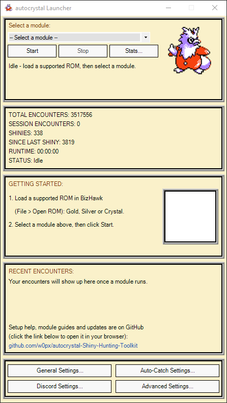
</p>


### BizHawk and the Launcher Move as One

<p align="center">
  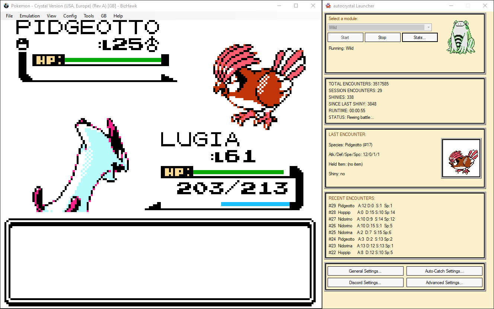
</p>

The two windows are docked together:

- **Drag either window** and the other one follows.
- **Resize BizHawk** and the launcher matches its height. When you let go, BizHawk's other side snaps to fit the game picture exactly, so there are no black bars.
- **Opening a ROM** (BizHawk resizes itself to its zoom setting) puts both back to the matched size.
- **Maximize BizHawk** to play full screen; restore it and they dock again.
- **[Game Assistant](#game-assistant)** docks against BizHawk's left side and **[Encounter Stats](#encounter-stats)** against the launcher's right side while they're open, as tall as the launcher, and move with the rest – dragging one moves the whole group. Each has a **Detach** button to let it go (it then stays wherever you put it); **Attach**, or closing and reopening it, docks it again. On a screen too narrow for all four windows, a docked window stays on screen and slides over its neighbour.

Prefer placing them yourself? Set `ARRANGE_WINDOWS = false` near the top of the helpers section in `autocrystal/launcher.lua`.

### Why BizHawk 2.11.1 Is Bundled

The bot is tested against exactly this BizHawk version, and its Lua scripting interface has changed between BizHawk releases before. Pinning it means an update can never break your hunt halfway through. BizHawk 2.11.1 doesn't need the internet, never updates itself, and runs on the .NET Framework that ships with Windows 10 and 11 – it can stay as it is.

The bundled `BizHawk` folder is also where your in-game saves (`BizHawk/Gameboy/SaveRAM/`), savestates and BizHawk settings live – back it up along with `autocrystal/`.

<details>
<summary>Using your own BizHawk install instead</summary>

- `start.exe` uses `BizHawk\EmuHawk.exe` next to it if it's there. Remove that folder and it looks for an installed BizHawk instead (or asks you to pick `EmuHawk.exe`) and remembers your choice in `autocrystal/start_settings.txt`.
- To start everything by hand, run BizHawk with the two flags Discord needs, then load the launcher in **Tools → Lua Console → Script → Open Script**:

  ```
  EmuHawk.exe --url_post=http://127.0.0.1:5000/ --url_get=http://127.0.0.1:5000/ --lua="<path>\autocrystal\launcher.lua"
  ```

- Other BizHawk versions may work, but only 2.11.1 is tested.

</details>


# The Launcher

<p align="center">
  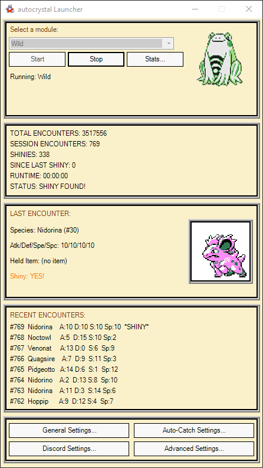
</p>

From top to bottom – every panel between the module picker and the settings folds up to its first line with its **-** button (**+** opens it again), right where it is; it remembers which are folded (all open to start). Docked, BizHawk takes the launcher's height, so folding a panel makes BizHawk (and the docked windows) shorter, and opening it makes them taller again:

- **Module picker** – choose a module, then **Start** / **Stop**. **Open ROM** loads a game without the launcher closing and rebuilding (greyed out while a module runs). Modules that need it show extra pickers here: the **Static target**, the **Egg source** and the **Savestate slot**.
- **Counters** – total (lifetime) encounters, this session's encounters, shinies, encounters since the last shiny, runtime and what the bot is doing right now.
- **Current Encounter** – species, DVs, held item and whether it's shiny, with the Pokémon's animated Crystal sprite (the shiny sprite for a shiny, an egg for an unhatched egg). It switches to a new Pokémon as soon as the battle with it starts, and keeps showing it until the next one. It also fills while you play yourself, with no module running. Before the first one it shows a short getting-started note.
- **Recent Encounters** – the last 8, with held items and `*SHINY*` marks.
- **Recent Shinies** – your last 5 shinies from every module, newest first, each with its shiny sprite: when, which Pokémon, and after how many encounters. Kept in `autocrystal/modules/data/shiny_history.txt`; it starts with the first shiny found after updating.
- **Settings** – four buttons, one per settings window below, and under them **Stats** ([Encounter Stats](#encounter-stats)) and **Game Assistant** ([Game Assistant](#game-assistant)), and **Open the guide on GitHub**, always there.

Every settings window works the same way: **Save** applies and remembers your changes (they're still there the next time you start the bot); closing a window with **X** throws them away. Your settings are stored in `autocrystal/modules/data/gui_settings.txt`. Options that don't apply to the running module are greyed out, and so are the ones your other choices rule out (for example **Tries** while **Always retry** is ticked). Click the **?** next to an option to see what it does, in the help line at the bottom of the window; click it again to hide it.

## General Settings

<p align="center">
  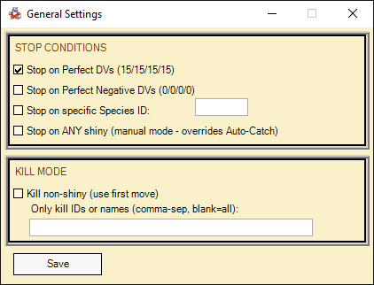
</p>

- **Stop Conditions** – stop on Perfect DVs, Perfect Negative DVs, a specific species (name or ID), or on **any** shiny. "Stop on ANY shiny" is the manual mode: it overrides Auto-Catch, so the bot stops and leaves the shiny to you.
- **Kill Mode** – battle non-shinies with the best of your Pokémon's moves instead of running, optionally only specific species, and optionally **use potions** after battles once HP is at 25% or less. See [Kill Mode](#kill-mode-experimental).

## Auto-Catch Settings

<p align="center">
  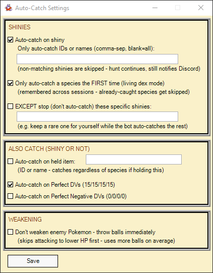
</p>

- **Shinies** – catch shinies automatically, optionally only certain species, only the **first** of each species (living dex mode, remembered across sessions), or with exceptions the bot stops for instead (e.g. keep a rare one for yourself).
- **Also catch (shiny or not)** – Pokémon holding a given item, Perfect DVs (15/15/15/15) or Perfect Negative DVs (0/0/0/0).
- **Weakening** – the bot lowers the target's HP before throwing, down to 40% or as far as it safely can – never with a move that could knock it out. There's nothing to set: a Lv 60 Lugia against a Lv 10 Pokémon has no move gentle enough, so it throws straight away.
  - **It picks the move** – out of all four. Before every attack it works out each move's damage the way the game does: your Pokémon's level and stats, the target's, the move's power and type, STAB, the type chart and the random roll. It then uses the move that takes the most HP while even its highest roll **with a critical hit** can't knock the target out. When no move can do that any more, it starts throwing. **False Swipe** is the best case (it always leaves at least 1 HP); **Super Fang** (half the HP), **Seismic Toss** and **Night Shade** (your level in damage) are counted exactly.
  - What it can't read, it takes at its worst: a badge's type boost, a type-boosting held item, rain or sun (only if the target knows Rain Dance or Sunny Day).
  - It never weakens with a move that can burn, poison, confuse or trap the target (those keep hurting it – or make it hurt itself – while the balls fly), and never with Explosion, one-hit KO moves, two-turn moves or moves that lock you in (Thrash, Rollout). A move the target is immune to (Normal against Ghost, Ground against Flying) is never used.
  - An over-levelled lead with no gentle move therefore throws straight away instead of risking a knockout.
  - **Weakening that gets nowhere** – a Pokémon that heals itself back up (Snorlax's Rest, Recover, Leftovers) or keeps dodging: once 3 attacks in a row haven't brought it below the lowest HP it's been at, or after 15 attacks in all, the bot stops attacking and throws at whatever HP it has. The log says so. When the bot goes back to the start of the battle to try again ([Safe auto-catch](#auto-catch-settings), Frame Rollback, the Static module), these counts carry over to the new try – it's the same Pokémon, so it heals itself back up again – and the new try throws straight away instead of attacking again (a shiny Lugia with Recover, for one).
  - With **Frame Rollback** on, a move only a **critical hit** could knock it out with is fine too: a knockout then just means a reset. Without rollback, if the bot can't work out what a hit would do, it throws without attacking.
  - Every pick goes to the log (`autocrystal/logs/autocrystal_log.txt`), e.g. "weakening with TACKLE (move 1): 12-15 damage, against 38 HP, up to 30 with a critical hit". If a hit ever takes more than the bot worked out (the target's own recoil or Substitute can do that), it says so and stops attacking that Pokémon – or, with Frame Rollback on, goes back to the old rule: move 1, and stop once another hit like the last one, doubled, could knock it out.
  - The moves' power, type and accuracy come from the game's own move table, which the bot finds in the ROM – Crystal, Gold, Silver and the Japanese versions all have it. On a game where it isn't found, it throws without weakening (with Frame Rollback on, the old rule applies).
  - **Send out the next Pokémon if yours faints** – a fainted lead no longer stops the bot. It answers "Use next POKéMON?" with YES, sends out the first healthy Pokémon in your party and keeps throwing balls with it – it never attacks with it, since its moves could knock the target out. It never sends out your **last** healthy Pokémon: if that one fainted too you'd white out, and the Pokémon you're catching would be gone for good. So with only one healthy Pokémon left it stops and pings Discord instead, with the battle waiting at "Use next POKéMON?" (nothing is lost while that question is up). The bot finds the game's own "Use next POKéMON?" and party-menu code by its bytes – it's there in Crystal and Gold/Silver – and on a version where it can't find it, it stops as before.
  - It and Frame Rollback rule each other out, so ticking one greys out the other: rollback already goes back to the start of the battle when your Pokémon faints.
- **Frame Rollback if Catch Fails** – off by default: a Pokémon that flees or faints is gone, and the hunt goes on. Tick **Roll back to the start of the battle and catch again** and the bot instead goes back to the start of that battle (the Pokémon on screen, your team as it was) and tries again – also when the catch gets stuck because your own Pokémon fainted. Works in the Wild, Fishing, Headbutt and Static modules (Static used to do this no matter what; now it follows this setting too).
  - **Tries** – how many attempts in all, the first one included (so 20 Tries is up to 19 resets), whatever ended the last one (it fled, it fainted, or the catch got stuck because your own Pokémon fainted): 20 if left blank, up to 999. Worth raising for a Pokémon you'll rarely see again.
  - **Always retry** – no limit at all: it keeps rolling back until the Pokémon is caught, or until you press **Stop**. Every retry waits a random moment at the battle menu first, so each battle plays out differently.
  - Out of tries, one that keeps fleeing is let go and the hunt carries on, and a stuck catch stops at the start of the battle for you to finish.
  - Balls run out: without rollback the bot stops with 3 balls left so you can finish by hand. With rollback it throws down to the last one and then resets – the reset gives every ball back – and only stops (at the start of the battle) once it's out of tries.
  - Leave it off if every encounter should only count once – no rollbacks.
- **Save a savestate file when a shiny appears** – any module: the moment a shiny turns up, the bot saves a savestate to `autocrystal/autosaves/shiny_<name>_<date>_<time>.State` (a shiny egg is `shiny_Egg_…`). Whatever happens next – a failed catch, a crash, a misclick – load it with **File > Load State > Load Named State...** and you're back at that moment. With auto-catch off, the bot stops right there anyway; the file just makes sure the moment can't be lost.
- **Balls** – before every throw the bot works out which ball in your Balls pocket has the best chance, the way the game does, and throws that one:
  - **Ultra Ball** ×2, **Great Ball** ×1.5, **Poké Ball** ×1 – each counted with the target's HP, as the game does.
  - **Lure Ball** ×3 on a Pokémon you hooked with a rod (the Fishing module) – it beats an Ultra Ball there. Anywhere else it's only a Poké Ball.
  - **Level Ball** ×2 when your Pokémon's level is higher than the target's, ×4 when it's over double, ×8 when it's over four times (a Lv 60 Lugia against a Lv 10). The game skips the HP part for it, so it's just as good at full HP – it often beats an Ultra Ball.
  - On a tie it takes Ultra, Great, Poké, Level, Lure in that order. The other Apricorn balls and the Park Ball are never thrown (Moon and Love Balls don't work in Gold, Silver and Crystal; the Fast Ball only for three species), and the Heavy Ball isn't either.
  - **Never a Master Ball** – auto-catch leaves it for you, and it doesn't count towards the 3 balls the bot keeps back either.
- **Discord** gets two messages per catch: one when the Pokémon is found, one with how it ended – with how many resets it took and which Balls were thrown, e.g. "used 3 Ultra Balls" or "used 2 Ultra Balls and 1 Poke Ball". A rollback gives the Balls back in the game, but every throw is counted (e.g. "used 47 Ultra Balls across 34 resets").

## Discord Settings

<p align="center">
  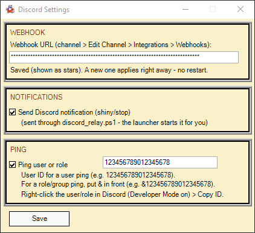
</p>

- **Webhook** – paste your Discord webhook URL here (it's shown as stars). A new one applies right away, even mid-hunt – no restart. See [Discord Notifications](#discord-notifications).
- **Notifications** – turn the shiny/stop notifications on or off.
- **Ping** – mention a user (their ID) or a role (`&` + the role's ID) with every notification.

## Advanced Settings

<p align="center">
  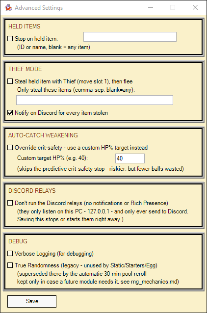
</p>

- **Held Items** – stop when a wild Pokémon holds an item (any, or a specific one).
- **Thief Mode** – steal held items with Thief, then flee. See [Thief Mode](#thief-mode).
- **Auto-Catch Weakening** – weaken down to your own target HP %, leaving critical hits out of the safety check: riskier, but fewer balls used.
- **Discord Relays** – don't run the two small local helpers that Discord needs, if you'd rather not have them (no notifications or Rich Presence then). Saving stops or starts them immediately. See [Why Are There Local Relays?](#why-are-there-local-relays)
- **Windows** – **Dark mode**: dark colors for the launcher and all of the bot's windows; the launcher art and the Pokémon sprites sit right on the dark background, with no white card – except the launcher's Current Encounter card, which stays white (the still sprites are made from the animated sprites' first frames, transparent around the Pokémon – made by themselves once sprites are downloaded). Every window takes its colors when it opens, so it switches the next time you start the bot.
- **Headbutt** – show the tree overlay on the game screen: what the tree in front of you can give, and whether battles where you stand get their DVs pinned. See [Picking a Spot: The Tree Overlay](#picking-a-spot-the-tree-overlay).
- **Debug** – Verbose Logging shows everything the bot does in BizHawk's Lua Console, plus extra detail; without it the console stays empty. Either way, everything goes to `autocrystal/logs/autocrystal_log.txt` (see [Verbose Logging](#verbose-logging)).

## Encounter Stats

<p align="center">
  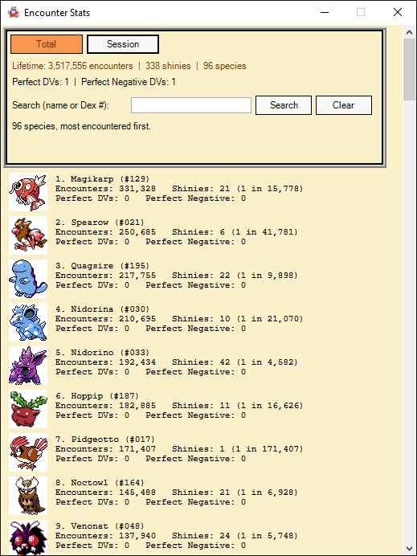
</p>

Opened with **Stats** at the bottom of the launcher, docked against the launcher's right side (**Detach** lets it go). Every species you've encountered, most encountered first:

- **Total** / **Session** tabs – lifetime numbers, or just this session's (with the active hunting time). Both show this session's **encounters per hour** – the same number as on Discord's Rich Presence.
- Encounters, shinies and your shiny odds ("1 in …") per species, plus Perfect and Perfect Negative DV counts.
- **Search** by name or Dex number.
- Updates live while the bot runs. Your stats are saved after every encounter and survive restarts.
- Only the bot itself counts. The stats file (`autocrystal/modules/data/wild_stats.txt`) stays readable, but it ends with a check line, so numbers typed into it by hand don't stick: the bot notices, keeps your edited copy as `wild_stats.edited.txt` and goes back to its last real save. That keeps what Discord's Rich Presence and notifications show honest.

## Game Assistant

Opened with **Game Assistant** at the bottom of the launcher: what's going on in the game right now – **whether the bot is running or you're playing yourself**. It only reads the game; it never presses a button, and nothing it shows counts toward your stats. Handy while you play through the game normally: you see what a wild Pokémon is holding before you decide to catch it, and which move to use. It's a tall window like the launcher, docked against BizHawk's left side (see [BizHawk and the Launcher Move as One](#bizhawk-and-the-launcher-move-as-one)); **Detach** lets it go.

<p align="center">
  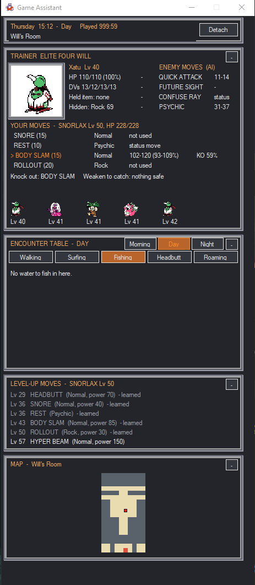
  &nbsp;
  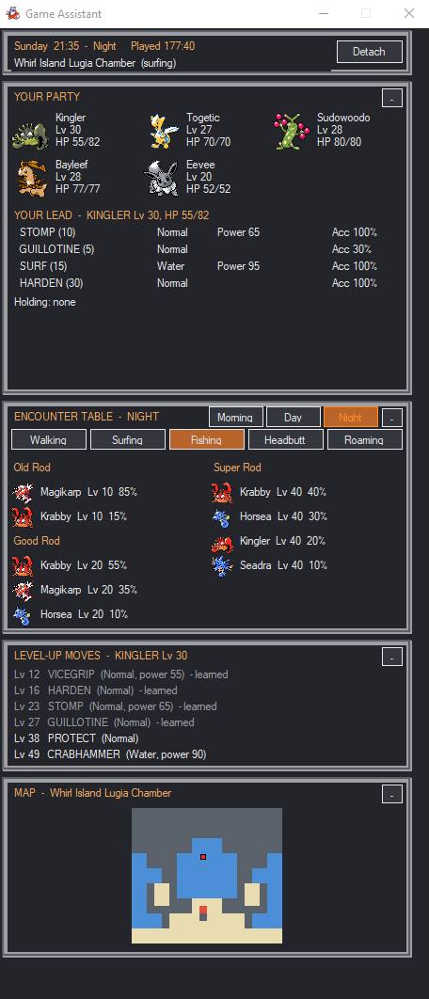
</p>
<p align="center"><i>Left: a trainer battle. Right: walking around, with the Fishing tab open.</i></p>

Every section below the clock folds up with its **-** button (**+** opens it again); it remembers which are folded (all open to start). Folding is instant. Docked, the window is as tall as BizHawk; when the open sections need more room, **scroll it with the mouse wheel** while the pointer is over it – there's no scroll bar to see (the docking helper keeps it hidden, so it may flash for a split second as you scroll).

### Clock and place

The in-game day, time and whether it's morning, day or night, your play time (as on the Trainer Card), and where you are (and whether you're surfing).

### Your party (outside battles)

Your party, 3 by 2, with sprites (the shiny sprite for a shiny, an egg for an egg), levels and HP.

### The other side (in a battle)

The wild Pokémon, or the trainer's Pokémon that's out, replaces the party:

- **Card** – its animated sprite, then its name and level, HP (with the share left), **DVs** (Attack/Defense/Speed/Special), **held item**, **Hidden Power** type and power, and a **SHINY!** mark.
- **Trainer battles** – the title says who you're fighting, read from the ROM the way the game shows it (e.g. **ELITE FOUR WILL**, or your rival's name). Under the card, the trainer's whole team with sprites and levels, fainted ones marked. On the Japanese games the name is left out (Japanese text isn't decoded).
- **Enemy moves** – on the right of the card, every move it knows, in three columns:

  | Column | What it shows |
  |---|---|
  | Chance | How likely it is to use the move next turn. A wild Pokémon picks at random among the moves it still has PP for, so each of those gets the same share (and a move out of PP shows 0%). A trainer's Pokémon shows **-**, since the trainer's AI weighs the situation – the title then says **(AI)** instead of **(random)**. A wild Pokémon with no PP left at all uses Struggle, and the title says so. |
  | Move | The move's name. |
  | Damage | What one hit does to **your** Pokémon, lowest to highest roll. **status** for a move that doesn't deal damage (Confuse Ray), **-** for one that can't hurt you (you're immune) or whose damage can't be worked out in advance (Future Sight). |

### Your moves

Always shown. **Outside battles** it's your lead – the first Pokémon that hasn't fainted, the one the game would send out – with each move's PP, type, **power** and **accuracy**, and its held item underneath.

**In a battle** it's the Pokémon fighting, and each move is worked out against the Pokémon facing you, the way the game does it: both Pokémon's levels and stats, the move's power and type, STAB, the type chart and the random roll (the same math as auto-catch's [Weakening](#auto-catch-settings)):

| Column | Example | What it means |
|---|---|---|
| Move (PP) | BODY SLAM (15) | The move and the PP it has left. A **>** in front, in orange, marks the **best move to knock it out**. |
| Type | Normal | The move's type. |
| Damage | 102-120 (93-109%) | One hit's damage, lowest to highest roll, and the same as a share of the target's **maximum** HP. |
| KO chance | KO 59% | The chance that one hit knocks it out **from the HP it has now**. It counts every damage roll, **critical hits** (Gen 2's real crit rates, including high-crit moves, Scope Lens and the Stick / Lucky Punch) and the move's **accuracy**. So a move that can only knock it out with a crit shows **KO <1%** or a few percent instead of 0%, and a sure knockout with a move that can miss shows less than 100% – Rock Throw (90% accurate) shows 89%. **False Swipe** says *never KOs*. |

Instead of damage, a move can say:

- **status move** – it doesn't deal damage (Rest, Growl, Thunder Wave).
- **no effect** – the target is immune (Normal against Ghost, Ground against Flying).
- **not used** – a move the calculator leaves alone because its damage isn't a plain hit: one-hit KO moves, Explosion/Selfdestruct, Counter, Present, Dream Eater, moves that lock you in (Thrash, Rollout) or only work in a certain state (Snore).

The line under the moves sums it up:

- **Knock out** – the move marked **>**: the best chance to knock it out this turn, or, when nothing can, the most damage. A two-turn move (Solar Beam, Skull Bash) counts half and Hyper Beam a little less, for the turn they cost you. Fly and Dig count 0.8: they take two turns too, but you're out of reach for the first one. *no move hurts it* when none can. It's the same pick Kill Mode makes.
- **Weaken to catch** – the move auto-catch would weaken with: the one that takes the most HP while even its **highest roll with a critical hit** can't knock it out, and that can't burn, poison, confuse or trap it. *nothing safe* means every move could knock it out (or none is fit for weakening) – throw balls instead.

### Encounter table

What can turn up where you stand at this time of day, with levels and chances, read from the game's own tables. **Morning**, **Day** and **Night** buttons in its title row show another time of day (the time it is now has orange text and is shown by default; click it to follow the clock again). One tab each, and it remembers the tab you picked:

- **Walking** (grass and caves) and **Surfing**.
- **Fishing** – per rod (Old, Good, Super), for this map's fishing spot (only on maps with water – the game gives nearly every map a fishing table, even ones you can't fish on, so a map without water says so), with the day or night Pokémon the Good and Super Rod can hook right now (Corsola by day, Staryu at night).
- **Headbutt** – the map's trees: common trees and rare trees (which kind a tree is depends on your trainer ID – the Headbutt module's tree overlay shows it). Gold and Silver have their own, different tree tables.
- **Roaming** – where the roaming legendaries (Raikou, Entei) are, with their sprites, with **HERE!** when one roams your map.

### Level-up moves

Of your Pokémon (your lead, or the one fighting in a battle): the moves it learned most recently (greyed, marked *learned*) and the ones still to come, at which level, with each move's type and power.

### Map

The map you're on, seen from above, with a red dot where you stand: grass and trees in green, water in blue, ledges in brown, doors and stairs in red, walls grey. It's built from the game's own map and collision data the moment you arrive on a map. **Click the map** to switch between the whole map and a close-up around you that follows you as you walk (big maps start in the close-up); your choice holds for every map after that.

### Games

Game Assistant works on Crystal, Gold and Silver (English, European and Japanese); on Gold/Silver the trainer's team and the roamers only show when they read right. Sprites come from the same one-time download as [Encounter Stats](#encounter-stats).

## Sprites

The sprites aren't part of the download. The first time you open Encounter Stats, click **Download sprites** – a one-time download of the Gen II Crystal sprites (still and animated, normal and shiny) from PokeAPI's open sprite collection. It also makes the sharper, larger versions the launcher's Current Encounter card plays, and the ones on Discord messages: trimmed to the Pokémon and enlarged to 72px, almost filling Discord's 80px corner (about 1.8× the size for most Pokémon). Without the sprites, everything works the same, just with text only – and Discord messages show the plain, smaller sprite.

The egg picture comes from `autocrystal/data/sprites/normal/egg.gif` (animated) – replace it with your own and run `autocrystal/tools/make_egg_sprites.ps1` to rebuild the launcher and Discord versions.


# Modules

## Wild Encounters Module

- Walks a loop round the edge of the encounter tiles where you start it, up to 3 steps out each way (at most a 24-step loop): tall grass, any cave floor, or the water while you're surfing. It reads the map the way the game does and never steps onto a door, stairs, a ledge, ice or into the next map. Where no loop fits, or someone keeps standing in the way, it walks a small square instead, and Right/Left where even that doesn't fit. On the English and European games (the Japanese ones walk the square). Phone calls and other text that come up while walking are pressed through with B
- RAM-verified menu navigation, self-corrects on dropped inputs
- Automatically handles phone calls and other interruptions (e.g. egg hatching)

### Stop Conditions

Set in [General Settings](#general-settings) and [Advanced Settings](#advanced-settings):

- **Perfect DVs (15/15/15/15)** – Stops when a Pokémon with perfect DVs is encountered
- **Perfect Negative DVs (0/0/0/0)** – Stops when a Pokémon with perfect negative DVs is encountered
- **Specific Species (Name or ID)** – Stops when a specified Pokémon is encountered, whether shiny or non-shiny
- **Held Item (Any or Specific)** – Stops when a Pokémon holding any or a specified item is encountered. If a specific item is set, the bot only stops for that item
- **Shiny Pokémon** – Stops on every shiny, unless [Auto-Catch](#auto-catch-settings) is set to catch it (tick "Stop on ANY shiny" to always stop)

### Kill Mode (experimental)

- Automatically battles non-shiny Pokémon with the best of your Pokémon's four moves: the one most likely to knock it out this turn (damage and accuracy, worked out the way the game does – see [Weakening](#auto-catch-settings)), else the one doing the most damage. A move out of PP is skipped, so all four get used before it runs out
- It never uses Explosion, one-hit KO moves or moves that lock you in (Thrash, Rollout), counts two-turn moves (Solar Beam, Skull Bash, Razor Wind) at half – they charge out in the open – and Fly and Dig at 0.8, since their first turn is spent out of reach and only the time counts against them. It never uses a move the target is immune to – against a Pokémon nothing can hurt, it flees
- On a game where the bot can't find the move table, it uses the move in slot 1, then slot 2 once that's out of PP, as before
- **Only favourable matchups** – before attacking, the bot reads the wild Pokémon's own moves: if it knows one that's super effective against your Pokémon (Peck against your Bug type), it runs instead. That's the overall matchup (a Bug/Rock Pokémon takes Peck normally, so it fights), only moves with PP left count, and fixed-damage moves like Seismic Toss or Dragon Rage don't. The log says which move it ran from. Also in the **?** next to Kill mode in General Settings
- Species allowlist on top of that – the bot only battles the Pokémon in the allowlist (ID or name)
- Automatically flees when no move has PP left or the active Pokémon's HP is at 25% or less
- **Use potions** (General Settings, under Kill mode, off by default) – heals up **between battles**: back in the overworld after a battle, if the Pokémon that fights next is at 25% HP or less, the bot opens Start → PACK, picks a potion from the Items pocket and uses it on that Pokémon, then carries on hunting. It takes the smallest one that heals it fully, or the biggest you have: Potion, Berry Juice (20 HP), Super Potion, Fresh Water (50), Soda Pop (60), Lemonade (80), Moomoo Milk (100), Hyper Potion (200), Max Potion, and Full Restore last (it's the most valuable). If that one isn’t enough, it keeps going while the HP still missing is at least what a potion heals (the biggest such one), so nothing is wasted: a 71 HP Pokémon at 15 HP with only Potions gets two (15 → 35 → 55) and stops, since a third would heal 20 for 16 missing. At most 6 in a row. Berries (you may want them as held items) and Energy Powder / Energy Root (they lower friendship) are never used. Every menu remembers where it was, so the bot reads where each cursor is instead of counting presses – it never lands on SAVE or walks off. With none left, Kill mode runs at low HP like before and the bot tells you once, on Discord too. Every potion goes to the log (e.g. "Use potions: used Super Potion - HP 21 -> 71/90."). Wild, Fishing and Headbutt, on the English and European games (not on the Japanese ones yet)
- When a Pokémon that already knows 4 moves is about to learn a new one, the bot stops at the prompt without pressing anything and pings Discord with the new move and the four it knows – choose in game which move to forget (or not to learn it), then click **Start**. With a free move slot it just learns the move and carries on
- As an extra safety net, Kill Mode saves a safety savestate (`kill_mode_safety.State`) to the `autocrystal/autosaves` folder the moment it's turned on, and refreshes a rolling backup (`kill_mode_autosave.State`) in the same folder every 5 minutes while it stays on – so you can always load one back to a recent, safe point if something goes wrong.


- Allowlist is set to Hoothoot only, so the bot escapes from any other encounter


### Thief Mode

- The bot uses the move **Thief** to steal held items from wild Pokémon, then flees
- Primarily used for money farming
- Optionally only steal specific items, and get a Discord notification for every item stolen
- The Thief Pokémon needs to be in party slot 1 without a held item, with Thief in attack slot 1
- Steals pause automatically while its HP is below 20% (the bot keeps hunting normally meanwhile)
- After a steal, the bot takes the item back off your Pokémon by itself (START → POKéMON → your lead → ITEM → TAKE), so Thief can steal again. Field moves your Pokémon knows (Cut, Fly, Surf, Strength, Flash, Whirlpool, Waterfall, Rock Smash, Headbutt, Dig, Teleport, Sweet Scent, Softboiled, Milk Drink) sit above ITEM in that menu – the bot counts them, so a Thief Pokémon that knows Cut or Headbutt works too. It checks the item is really gone afterwards and tries once more if not; if it still can't (a full Bag pocket stops it), the log says so and you take it off by hand


### Verbose Logging

The bot always keeps a log, `autocrystal/logs/autocrystal_log.txt`: everything it reports, with the time of each line, every Start and Stop (with the module, the ROM and your settings), and the full error message if the bot ever crashes. BizHawk's Lua Console stays empty while it runs.

Tick **Verbose Logging** in [Advanced Settings](#advanced-settings) to see it all live in the Lua Console as well, along with extra detail on every action the bot takes – the detail goes into the log file too. It's meant for debugging: if something goes wrong, tick it, run the bot until the problem happens again, and send `autocrystal_log.txt` with your report.

At 4 MB the log moves to `autocrystal_log.old.txt` and a new one starts, so the two never take more than 8 MB and are small enough to attach to a Discord message. Your Discord webhook and ping ID are never written to it.


## Starters Module

Place the bot directly in front of the starter Pokémon without interacting with the Poké Ball.


Select **Starters** in the launcher and click **Start**. The bot saves your position to savestate slot 3 (changeable in the **Savestate slot** picker) – don't touch that slot while it runs. It doesn't soft-reset: it uses **[Frame Search](#frame-search-trying-every-frame)**, picking the starter on every frame in turn and rewinding after each one, so no frame is ever tried twice. Every starter it rolls shows up in Recent Encounters:

<p align="center">
  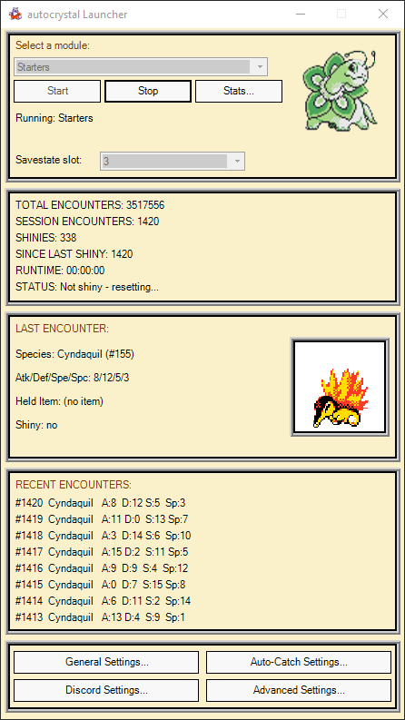
</p>

On a shiny (or Perfect / Perfect Negative DVs, if you ticked those stops) it picks the starter on that exact frame for real and stops. A phone call that rings during the search is answered automatically – see [Phone calls during a search](#phone-calls-during-a-search).


## Fishing Module

- A Pokémon that knows **Surf** can stay in your party: the bot clears the fishing text with B, never A, so it can't answer "Want to SURF?" with YES – and if a stray A after a battle ever does, it steps back onto the shore and faces the water again before the next cast
- Automatically handles phone calls and other interruptions (e.g. egg hatching)
- Register your fishing rod on the Select button: Pack → Fishing Rod → SEL
<p align="center">

</p>
- Stand facing a water tile
<p align="center">

</p>

## Headbutt Module

- Automatically handles phone calls and other interruptions (e.g. egg hatching)
- Stand facing a Headbutt tree and start the module – see [How Headbutt Trees Work in Gen 2](#how-headbutt-trees-work-in-gen-2) for picking a good tree
- Turn on the tree overlay (Advanced Settings) before you start: it tells you whether the tree in front is a rare tree, and whether the spot is **rigged** – some spots make shinies far rarer, or impossible for some species. See [Rigged Spots: The Speckle Transition](#rigged-spots-the-speckle-transition)
<p align="center">

</p>

## Egg Module

- Pick the **Egg source** in the launcher: the **Togepi** egg or the **Odd Egg**
- Stand in front of the NPC who hands you the egg, without interacting
- The bot uses **[Frame Search](#frame-search-trying-every-frame)** from where you stand (saved to savestate slot 4, changeable in the **Savestate slot** picker) until an egg holds a shiny, then takes that egg for real and stops
- Automatically answers phone calls that ring during the search ([Phone calls during a search](#phone-calls-during-a-search))
- Walk it until it hatches

<p align="center">

</p>
<p align="center">
  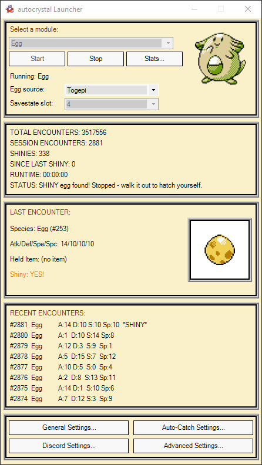
</p>


## Static Module

- Pick the **Static target** in the launcher – Sudowoodo, Eevee, Shuckle, Spearow, Celebi, Lapras, Suicune, Snorlax, or **Static (open world)** for any other static encounter
- Stand where the encounter starts, without interacting: in front of the NPC handing you the Pokémon / in front of the static encounter (for Suicune: outside Tin Tower's door – the bot walks in by itself)
- Click **Start**. The bot doesn't soft-reset – it uses **[Frame Search](#frame-search-trying-every-frame)**: it tries every frame you could start the encounter on, one after another, and rewinds after each one, so no frame is ever tried twice
- BizHawk runs unthrottled and muted while searching (your speed and sound settings come back afterwards). Every new Pokémon it rolls counts as an encounter and shows up in Recent Encounters
- Automatically answers phone calls that ring during the search ([Phone calls during a search](#phone-calls-during-a-search))
- On a shiny (or Perfect / Perfect Negative DVs) it plays that exact frame for real, so the battle starts with that Pokémon, then stops or [auto-catches](#auto-catch-settings) as usual. With [Frame Rollback](#auto-catch-settings) on, if the Pokémon gets away during auto-catch (it used Selfdestruct/Explosion) or the catch gets stuck (your Pokémon fainted), the bot goes back to the start of that battle – the shiny on screen, your team as it was – and tries again, as many times as you set. If it still can't catch it, it stops at the start of the battle so you can take over
- Savestate slot 5 (changeable in the **Savestate slot** picker) holds your position: saved on **Start**, and moved on whenever a shiny is found, so the search continues from there
- Progress (speed, distinct DVs found, catch attempts, answered phone calls) is written to `autocrystal/logs/frame_search_log.txt`
<p align="center">

</p>

## Game Corner Module

- Talk to the vendor and open the prize menu, with the cursor on the Pokémon you want to hunt – don't select it yet (Start anywhere else and the bot tells you to open the menu first)
- The bot uses **[Frame Search](#frame-search-trying-every-frame)** from there (saved to savestate slot 6, changeable in the **Savestate slot** picker) until the prize is shiny, then buys that one for real and stops


## Friendship Module

- Automatically grinds Pokémon friendship by walking
- Every **500 steps**, the friendship of all Pokémon in the party increases by **1**
- Shows the friendship value of the **first Pokémon in the party** in the launcher
- Sends a Discord notification once **220 friendship** is reached
- For a Pokémon that evolves by friendship (Golbat, Chansey, Pichu, Cleffa, Igglybuff, Togepi, Eevee), the notification says what it evolves into once it levels up – for Eevee, Espeon in the morning or day and Umbreon at night. For any other Pokémon it just says the maximum was reached
<p align="center">

</p>

# FAQ

## Supported Versions

| Game | US | EU | JP |
|------|:--:|:--:|:--:|
| Crystal | ✅ | ✅ | ✅ |
| Silver | ✅ | ✅ | ✅ Rev A |
| Gold | ✅ | ✅ | ✅ |

**The Japanese versions** – Pocket Monsters Kin (Gold), Gin (Silver, Rev A) and Crystal. No symbol files exist for them, so their addresses were found by matching every routine of the English code in each Japanese ROM (`modules/data/gs_jp.lua` says how). Only the revisions that were checked run – Kin and Crystal as first released, Gin Rev A; on any other the modules stop and say so. The Korean versions aren't covered. The Game Assistant hides the trainer's name on the Japanese games (Japanese text isn't decoded).

## Transferring Save Files from One Emulator to Another

Let's use BizHawk and mGBA as an example.

BizHawk save states (`.State`) and mGBA save states are **not compatible**.

A save state contains the complete internal state of a specific emulator core. Since BizHawk's **Gambatte** core and mGBA's **Game Boy** core are completely different implementations, save states cannot be transferred between them, regardless of the file extension.

Instead, use the game's **battery save (SRAM)** – the same save data created when you save through the in-game **SAVE** menu.

### Steps

1. In **BizHawk**, save the game using the in-game **SAVE** option (just like on a real Game Boy cartridge).
2. Ignore the save state dialog – you do **not** need to export or convert a save state.
3. Open the bundled BizHawk folder and go to:
   ```
   BizHawk/Gameboy/SaveRAM/
   ```
4. Locate the generated `.SaveRAM` file, for example:
   ```
   Pokemon - Crystal Version (USA, Europe) (Rev A).SaveRAM
   ```
5. Copy the file to the same folder as your mGBA ROM.
6. Rename the file so it matches the ROM filename exactly, using the `.sav` extension.

   **Example:**
   ```
   ROM:  Pokemon Crystal.gbc
   Save: Pokemon Crystal.sav
   ```
7. Launch the ROM in **mGBA** normally using **File → Load ROM**. If the `.sav` file is in the same directory and has the correct filename, mGBA will automatically load your save.

The same works in reverse: put an `.sav` from another emulator into `BizHawk/Gameboy/SaveRAM/`, renamed to match the ROM like the existing file there.

## Emulator Speed

| Emulator Speed | Status |
|----------------|--------|
| 100% | Fully Supported ✅ |
| 200% | Fully Supported ✅ |
| 400% | Fully Supported ✅ |
| Unthrottled | Fully Supported ✅ |

## Discord Notifications


The bot posts to a Discord channel of your choice when something happens – a shiny found or caught, a stop condition met, an item stolen, the bot getting stuck, 220 friendship reached – each with the Pokémon's **animated** Crystal sprite (or the egg, for the Egg module).

### Setup

1. **Create a webhook** in Discord: Server Settings → Integrations → Webhooks → **New Webhook** (or on a channel: Edit Channel → Integrations → Webhooks), then **Copy Webhook URL**.
2. In the launcher, open **Discord Settings**, paste it into **Webhook URL** (its **?** shows where to find it in Discord) and click **Save**. Your first webhook switches notifications on automatically.
3. *(Optional)* Tick **Ping user or role** and enter a user ID, or `&` plus a role ID. (Enable Developer Mode in Discord, then right-click the user/role → Copy ID.)

That's it. `start.exe` already starts BizHawk with the flags the notifications need, and the launcher starts the relay in the background. Changing the webhook later takes effect immediately, even mid-hunt.

### Rich Presence

While a module runs, your Discord profile shows an **autocrystal** activity card with the game you're playing, what the bot is doing (e.g. **Static (Electrode) - Team Rocket Base B2F**), your total encounters, shinies and encounters per hour. It needs the Discord desktop app running on the same PC – no setup.

## Why Are There Local Relays?

**Short answer:** It's a workaround for BizHawk limitations, not anything that sends data out from your PC on its own.

### The problem they solve

BizHawk's Lua `comm.httpPost()` function always wraps its request body as a URL-encoded form field (`payload=`). This is fixed behavior in every BizHawk version, not a bug.

Discord's webhook API, however, expects **raw JSON** and rejects form-encoded requests. As a result, BizHawk cannot talk to Discord directly, regardless of how the Lua script is written. Likewise, BizHawk's Lua can't reach the Discord app's local Rich Presence connection at all.

### What the relays actually do

Two small PowerShell scripts in the `autocrystal` folder, started hidden by the launcher:

- **`discord_relay.ps1`** (notifications) listens only on **127.0.0.1:5000**, receives BizHawk's form-encoded message, decodes it back into plain JSON and forwards it to **your** Discord webhook – the one saved in Discord Settings. For the Egg module it also uploads the egg picture with the message.
- **`discord_presence_relay.ps1`** (Rich Presence) listens only on **127.0.0.1:5001** and passes the bot's stats to the Discord app running on your PC.

That's all they do – **decode, forward, done.** Both quit by themselves when BizHawk closes, and log what they did to `autocrystal/logs/discord_relay_log.txt` and `presence_relay_log.txt`.

### Why this is safe

- ✅ They listen only on **127.0.0.1 (localhost)**, meaning **no other device or internet host can connect to them**
- ✅ They require **no administrator privileges**
- ✅ Plain-text PowerShell scripts – open them in any text editor and inspect every line yourself
- ✅ No hidden or obfuscated code
- ✅ The notification relay only ever sends to a real **Discord webhook URL** (`https://discord.com/api/webhooks/...`) – it refuses anything else, whatever ends up in the settings
- ✅ The only files it ever uploads are pictures from `autocrystal/data/sprites/`
- ✅ The only information forwarded is what the bot generates (e.g. Pokémon species, DVs, shiny/stop message)
- ✅ No system information, credentials, or personal data are collected or transmitted
- ✅ The logs show only your webhook's ID, never the secret part of its URL

### How to verify this yourself

- Read `discord_relay.ps1` and `discord_presence_relay.ps1`
- Check **Windows Firewall**, **Resource Monitor**, or **TCPView** while they're running – you'll see them bound only to **127.0.0.1**, never `0.0.0.0` or your network IP
- Discord is completely **optional**. Tick **Don't run the Discord relays** in [Advanced Settings](#advanced-settings) and they never start – the bot works exactly the same without them.

## Savestate Slot Usage

The Starters, Egg, Static and Game Corner modules keep your position in a BizHawk savestate slot: it marks where their [Frame Search](#frame-search-trying-every-frame) starts, and lets it carry on after a shiny. You never need to save it yourself – each module saves your current position to its slot automatically every time you click **Start**.

Your only manual step is positioning your character correctly (facing the starter Poké Ball, facing the egg-giving NPC, etc.) before clicking Start – the bot takes it from there.

Each module has its own default slot so they don't collide if you switch between them in the same session. You can pick a different one (1–10) in the launcher's **Savestate slot** picker, which appears for these modules:

| Default Slot | Module | Position (auto-saved on Start) |
|------|--------|------------------------------------|
| 3 | Starters | Right before picking a starter |
| 4 | Egg | Right before talking to the egg-giving NPC |
| 5 | Static | Where the encounter starts |
| 6 | Game Corner | Right before talking to the vendor |

With the defaults, slots 1–2 and 7–10 are free for your own manual use. The Wild, Fishing, Headbutt and Friendship modules don't use a slot.

Every time you click **Start** in one of these modules, it copies whatever was already in its slot to `autocrystal/autosaves/` first, before saving your position there (`savestate_backup_slot<N>_<module>_<date>.State` – with the Static target or Egg source in the name too, e.g. `savestate_backup_slot5_Static_Suicune_<date>.State`). A save you kept in that slot is never lost.

## Logs and Autosaves

Everything the bot writes while it runs goes into two folders inside `autocrystal`, made automatically the first time:

| Folder | What's in it |
|--------|--------------|
| `logs/` | `autocrystal_log.txt`, the bot's main log (see [Verbose Logging](#verbose-logging)); one encounter log per module (`wild_encounter_log.txt`, `static_encounter_log.txt`, …); `frame_search_log.txt`; and the Discord relays' logs |
| `autosaves/` | Kill Mode's `kill_mode_safety.State` and `kill_mode_autosave.State`, the slot backups described in [Savestate Slot Usage](#savestate-slot-usage), and `shiny_<name>_<date>_<time>.State` from [Save a savestate file when a shiny appears](#auto-catch-settings) |

None of the logs can grow without end. Each one moves to an `.old` copy once it's full – replacing the copy before – and starts again:

| Log | Full at |
|-----|---------|
| `autocrystal_log.txt` | 4 MB |
| Encounter logs | 20,000 lines (about 1.5 MB) |
| `frame_search_log.txt` | 1 MB |
| Discord relay logs | 1 MB |

So each log, its `.old` copy included, never takes more than twice that.

To load an autosave in BizHawk, use **File > Load State > Load Named State...** and pick the file.

Your settings and lifetime stats stay in `autocrystal/modules/data/`. Older versions of the bot put their logs and safety savestates there too. Those files stay where they are: move or delete them as you like.

# Simulating Randomness: RNG Manipulation in Deterministic Emulation

## What "randomness" actually means in software

Almost nothing in software is truly random. What games (and most computer systems) use is a **pseudo-random number generator (PRNG)**—a completely deterministic algorithm that takes some internal state, transforms it with a fixed mathematical formula, and produces output that looks statistically random.

Given the exact same starting state and the exact same sequence of calls, a PRNG produces the exact same "random" output every single time. That's not a bug—it's how PRNGs are built.

On real hardware, this determinism is normally invisible. A PRNG's internal state is usually tied to something like elapsed CPU cycles since power-on, and in real life no two play sessions have identical timing down to the cycle because a human's button presses are never frame-perfect.

The PRNG is still deterministic—it just never sees the same inputs twice, so it feels random.

---

## Where this breaks: Deterministic emulation

Tools like **BizHawk** are deliberately engineered for perfect, bit-exact determinism—a core requirement for tool-assisted speedrunning, where a recorded input sequence must replay identically on any machine, forever.

That same property is exactly what breaks "randomness" for automated, reset-based interaction with a game's PRNG:

- Reload the same save state.
- Replay the same inputs.
- The emulator restores the exact same PRNG state.
- The game produces the exact same "random" result every single time.

This isn't specific to any one game; it affects any automation that repeatedly resets and retries against a deterministic emulator.

---

## Simulating randomness on purpose

Since the natural source of entropy (human timing variance) is gone, an automation script has to manufacture some on purpose.

Typically this is done by deliberately varying frame timing between attempts so the PRNG's state differs each time even though the algorithm itself stays perfectly deterministic.

This isn't generating true entropy—it's artificially reintroducing the timing variance that a human player would naturally provide.

The bot used to do this with random delays after every reset, described next. Today the **Starters**, **Egg**, **Static** and **Game Corner** modules go further and try every frame in order instead—see [Frame Search](#frame-search-trying-every-frame).

---

## The naive approach—and its hidden trap

The obvious solution is adding one random delay after every reset.

The problem is that if the PRNG's state depends on a deterministic value such as elapsed frames, then a delay of **1–N frames** can only ever reach **N distinct PRNG states**, regardless of how many thousands of attempts are made.

A delay range that's too small doesn't merely reduce randomness—it silently limits which outcomes are mathematically reachable, potentially preventing some rare results from ever occurring.

---

## A better technique: Splitting delays across multiple points

Rather than using one large delay (which guarantees better coverage but dramatically increases average attempt time), the delay can be split across several different points in the automation sequence.

These split points occur naturally during gameplay, for example:

- Button presses
- Dialogue
- Animations
- Menu transitions

Testing consistently showed that distributing delays across genuinely different gameplay moments produced much better state coverage per unit of waiting time than placing all randomness into one large delay.

---

## Where splitting reaches its limit

Splitting delays improves efficiency, but it doesn't remove the underlying limitation—it only distributes the same waiting time more effectively.

When testing Pokémon Crystal's DV generation while gradually increasing the delay range, two clear observations emerged:

- **Delay range mattered far more than the number of split points.**
  - Doubling the number of split points barely changed measured DV coverage.
  - Doubling the delay range (256 → 512 frames) increased measured coverage from roughly **2–6%** to roughly **21%**, making it by far the most significant improvement observed.

- **Coverage never approached 100%.**
  - Even with delay ranges four to eight times larger than the original implementation, most DV combinations remained permanently unreachable from a single save state.

This ruled out the obvious conclusion of simply "making the delay bigger." Something deeper was imposing a hard ceiling.

---

## The actual mechanism: One shared hardware timer

Inspecting the game's disassembly—not just its observed behavior—revealed why.

Generation II's RNG is not two independent random draws.

Instead, both running totals are updated from the same hardware timer sample every time the RNG function executes:

```text
hRandomAdd += [timer sample]
hRandomSub -= [timer sample]
```

The Attack/Defense DV roll and the Speed/Special DV roll are simply two consecutive calls to this same routine.

Because both draws originate from the same timer sample instead of two independent sources, they are **correlated**.

Increasing delay ranges cannot make them independent because only one underlying timer value exists.

---

### The hardware limitation

The timer itself advances only once every **256 CPU cycles**.

One Game Boy frame lasts **70,224 CPU cycles**.

Since:

```text
70,224 mod 256 = 80
```

A script that can only advance whole frames can only ever observe **16 distinct timer phases** out of the timer's 256 possible phases.

That ceiling is imposed by the Game Boy hardware itself.

It does **not** change by:

- increasing the delay range,
- adding more split points,
- or simply waiting longer.

Splitting delays only improves exploration of the states already reachable from a save state—it cannot expand that reachable set.

That limitation belongs to the exact instant the save state was captured.

---

## Re-rolling the save state

Since the limitation belongs to the save state rather than the delay strategy, the only way to move beyond it is to periodically stop reusing the same save state.

The implemented solution (used by the **Starters**, **Egg** and **Static** modules until Frame Search replaced it) is straightforward:

- Every **30 minutes**, the script performs one large, full-range entropy injection.
- It then immediately creates a brand-new save state.
- All subsequent resets begin from this newly generated baseline.

Each newly captured save state has its own unique set of reachable RNG states.

This mirrors real gameplay: if a human walks away and returns later, the game's internal RNG registers have naturally drifted, meaning a save captured later starts from an entirely different baseline.

Practically, this means that if one save state's reachable set excludes every desired outcome, that state is no longer a permanent dead end—it simply represents one unlucky 30-minute window before the next automatic re-roll replaces it.

---

## The trade-off: Wide and slow vs. narrow and fast

Introducing periodic save-state re-rolling changes the optimization problem completely.

Before re-rolling existed, larger delay ranges were preferable because they expanded the portion of the reachable state space explored.

Once the save state itself is periodically refreshed, however, spending additional time squeezing more coverage from a single save state becomes much less valuable.

A "bad" save state—one whose reachable set excludes every desired outcome—lasts the same **30 minutes** regardless of how large that reachable set is.

Modeling real measured throughput showed that:

- Narrow delay ranges complete significantly more attempts within each 30-minute window.
- Wider delay ranges complete far fewer attempts, despite slightly better coverage.

The increased number of independent windows explored over time outweighs the improved coverage of any individual window.

For that reason, the delay range was intentionally reduced after introducing periodic save-state re-rolling.

Once the ceiling itself is guaranteed to reset, **speed becomes the dominant optimization.**

## Honest limitations

This approach **cannot mathematically prove 100% coverage**.

Since the emulator is fully deterministic, every specific combination of delays always maps to one fixed outcome.

The automation samples random combinations—it does **not** exhaustively test every possible combination.

There is therefore no guarantee that every possible outcome has a reachable path through any particular delay strategy.

Real hardware has the exact same philosophical limitation.

A physical Game Boy's RNG isn't "true" random either—it's exactly as deterministic as an emulator's, just seeded by genuinely unpredictable human timing instead of scripted delays.

Neither approach is provably complete.

What **can** be measured is whether the observed distribution behaves like ordinary statistical randomness or whether it shows obvious structural bias—for example, a very small set of outcomes repeating constantly no matter how long the automation runs.

That distinction is empirically testable, even if complete coverage is not.

---

## The real fix: Frame Search: Trying Every Frame

The **Starters**, **Egg**, **Static** and **Game Corner** modules drop random delays altogether. Instead of resetting and *sampling* random timings, they **try every frame in order, exactly once**:

1. Snapshot the game (an in-memory save state—instant, no file).
2. Press A (or walk, for Suicune) and run the game only until the DVs are rolled—when the battle starts, or the Pokémon or egg lands in your party.
3. Note the DVs, then rewind to the snapshot.
4. Let one frame pass, and repeat.

```text
frame 1000: snapshot → press A → DVs rolled → rewind
frame 1001: snapshot → press A → DVs rolled → rewind
frame 1002: snapshot → press A → DVs rolled → rewind
...
```

This is the same idea as RNG manipulation in speedruns. Nothing is written to the game's memory and every Pokémon comes from the game's own code—the bot only chooses **the frame you press A on**, like a player with perfect timing who gets to try every moment.

It removes the problems of the reset approach:

- **No repeats.** Random delays keep landing on timings that were already tried; walking forward frame by frame never tries the same frame twice.
- **No ceiling from one save state.** The search keeps moving forward in time instead of returning to one save state, so it isn't limited to that state's reachable set—and there's nothing to re-roll.
- **No waiting.** No random delays and no reloads: BizHawk runs unthrottled, and each try ends the moment the DVs are rolled.

Measured on the Team Rocket Base Electrode:

| | Random resets | Frame search |
|---|---|---|
| New DV combinations | ~516 per 30-minute window | ~4.3 per **second** |
| Distinct combinations after 18 minutes | – | 4,687, still rising steadily |
| Expected time to a shiny (8 of 65,536) | several hours | ~30 minutes |

It still can't promise that one particular DV combination will ever come up—which combination a frame rolls is up to the game—but it never spends a try on a frame it has already seen.

### Skipping duplicate frames

The overworld only reacts to A every other frame, so two neighbouring frames often start the exact same encounter—about half of all tries were exact repeats of the frame before. A fixed "every second frame" rule doesn't work, because that rhythm drifts.

Instead, each try fingerprints the game's entire memory a few frames in and compares it with the previous frame's at the same moment. Identical memory means an identical result, so the rest of that try is skipped. The first 300 frames of every search are always tried in full to prove this holds for that encounter, every 25th skipped frame is still tried in full as a check, and a single wrong check switches skipping off for the rest of the search. With skipping, new DV combinations went from 2.4 to 4.4 per second.

Whether a target repeats like this depends on how its encounter starts. Electrode (one A press) and Suicune (walking in, then a cutscene) repeat every second frame like clockwork. Where the bot has to click through dialogue before the DVs are rolled, its later presses usually land a frame apart and change the roll, so neighbouring frames rarely repeat at all. The check then fails, skipping stays off, and every try is a new encounter anyway.

**What you'll see while it runs:**

- **Repeats don't count.** A repeat is the very same Pokémon as the try before, DVs and all, so it isn't added to Current Encounter, Recent Encounters or your stats. Otherwise every encounter would show up twice, and "since last shiny" would count double. So during the warm-up, about every second encounter you see on screen gets rewound without showing up in the launcher. That's normal: nothing was missed.
- **The status line shows it.** For example "80 offsets (0 skipped), 40 different DVs" means 80 frames tried, 40 of them new encounters and the other 40 repeats.
- **The warm-up is the first 300 tries of every Start.** After that, a line in `autocrystal/logs/frame_search_log.txt` says the search will now skip repeats:

  ```text
  -> from now on an offset in the same state as the previous one is skipped after 12 frames (every 25th probed fully as a check)
  ```

  From there on, a repeat is dropped after 12 frames instead of playing out, the "skipped" count in the status climbs, and new encounters come about twice as fast. On Electrode it went from 4.6 to 9.1 tries a second, with 0 wrong checks in thousands of skips.
- **Slow targets take a while to warm up.** A Suicune try takes about 889 frames (walking in plus the cutscene), against Electrode's 237, so its 300-try warm-up lasts about 5–6 minutes after each Start.

### Phone calls during a search

Between tries the game stands idle in the overworld, so a phone call can ring there, just as it would for a player standing still. Left alone, that call stays on screen in every snapshot from then on, and each try has to click through the whole call before its own A press does anything. In a Shuckle search, every try after the call took about twice as long.

So before each try, the bot checks whether a script is running, and if one is, it presses B until it's over. B moves the call's text on and answers NO to any question, so nothing gets accepted by accident. Each answered call gets a line in `frame_search_log.txt`.

Spotting the call takes two checks. The game keeps a "script running" flag, but during an incoming call Crystal's own code leaves it at 0. The phone check is reached through a far call that hands back a leftover register value, and that 0 is written over the flag. The game's "script mode" is set for every script, the call included, so the bot looks at both.

Game Corner doesn't need this: its search runs inside the prize menu, where calls can't ring.

### When a shiny turns up

A try is only a look-ahead—the shiny isn't in your game yet. The bot saves the next frame to the savestate slot (so the search can carry on later), rewinds to the shiny's frame and plays it **for real**: same frame, same DVs. From there the module's normal handling takes over: it stops, or—for a Static battle—auto-catches.

With Frame Rollback on ([Auto-Catch Settings](#auto-catch-settings)), if a Static Pokémon gets away during auto-catch, or the catch gets stuck because your Pokémon fainted, the bot rewinds to the start of that battle—the same shiny on screen, your team as it was—and waits a random moment at the battle menu first, so the battle itself plays out differently.

### Does the search ever repeat itself?

The search's frame counter just keeps going up: 1, 2, 3, … 30,000 and beyond. It never wraps around to 0. (The 1–64 frame delays you might have seen belong to the Wild, Fishing and Headbutt modules, which wait a random moment before each encounter. Frame Search doesn't use them.)

The game's results do run in a loop, though. Crystal's random numbers are two bytes that the game updates every frame using a hardware timer that never stops. That timer moves on by a slightly different amount each frame, in a pattern that repeats every 16 frames. In a simplified model that only counts this once-per-frame update, the timer and both bytes come back to exactly the same combination every **131,072 frames**, about 37 minutes of game time. After that, the same results come round again in the same order.

For a gift or a static encounter, the game rolls the two DV bytes straight after each other, so the second one is basically the first one minus the timer. The two are linked rather than independent. In the model, one loop of 131,072 frames holds **between 7 and 28 shiny frames**, depending on the setup (things like where in the frame the roll happens). Truly random DVs would give 16. So for one setup the odds sit somewhere between about 1 in 18,700 and 1 in 4,700, and only averaged over setups do they come out at 1 in 8,192. It would also mean a shiny is guaranteed somewhere in the first 131,072 tries of a search.

Two caveats:

- The model leaves out everything else that rolls a random number, like someone walking around, or the phone check, which rolls a 50/50 every time its timer runs out (every 3 to 20 minutes of game time, even while you stand still). Each of those knocks the sequence onto a different loop, so the real game repeats far less neatly than the model.
- The model hasn't been checked against the real game yet. So far, real searches look just like truly random DVs: one Shuckle search found 24,796 different DV combinations in 31,301 tries, where random DVs would give about 24,900.

None of this comes from BizHawk. Its Game Boy core copies the real console's timing down to the clock cycle, so the same presses on the same frames give the same Pokémon on a real Game Boy Color.

---

### A small aside: Determinism in miniature

The entire RNG manipulation problem ultimately comes down to one simple rule:

> **Same input → same result.**

Give a PRNG the same starting state and the same sequence of calls, and it will always produce identical output.

Everything described above—the split delays, the coverage testing, the save-state re-roll and frame search—exists solely to deliberately vary those inputs instead of replaying identical ones.

This project ends up illustrating a broader concept:

### Deterministic chaos

The RNG is fully known.

We can literally read the formula.

Yet it still *feels* unpredictable because we, as an external script, cannot control timing precisely enough to predict the exact starting conditions every attempt.

Nothing about the system is actually random.

The unpredictability comes entirely from imperfect control over its initial conditions.

This is the same reason classical systems like:

- Dice rolls
- Coin flips
- Weather

appear random despite being governed by deterministic physics.

Newtonian mechanics never stops applying to a tumbling coin.

"Randomness" in those cases is simply a statement about our own ignorance—not about the system itself lacking a cause.

Worth noting:

This says **nothing** about whether quantum mechanics contains fundamentally irreducible randomness or whether hidden-variable theories might ultimately describe reality.

That remains an open question in modern physics.

Our RNG is unquestionably deterministic because we can inspect the algorithm directly.

This project is therefore a demonstration of **classical determinism disguised as randomness**, not evidence for or against quantum interpretations.

---

### Applying this elsewhere

Any automation that repeatedly resets against a deterministic emulator's RNG encounters the same fundamental problem.

The general recipe is:

1. Confirm that repeated resets produce identical outcomes.
2. Introduce random timing delays.
3. Verify empirically that the results actually become more diverse.
4. If one delay still produces limited variety, split it across multiple distinct points instead of simply making one delay larger.
5. Measure actual coverage using real sample data rather than assuming the solution worked.
6. If the emulator can snapshot and rewind instantly, skip randomness altogether: try every frame in order instead (see [Frame Search](#frame-search-trying-every-frame)).

The important part is **measurement**.

Don't assume a timing strategy is effective simply because it contains "random" delays—verify that the observed distribution actually behaves like randomness.

## How Headbutt Trees Work in Gen 2

A tree's identity is permanently fixed, not random per attempt. Which encounter table a tree draws from (and its encounter rate — 80%, 50% or just 10%) is determined by a formula using your Trainer ID plus that tree's exact map coordinates. It's baked into your save file the moment that tree exists on the map — it never rotates, never moves to a different tree, and doesn't change between attempts.

Trees don't deplete. Unlike the HGSS remakes (where a tree that gives nothing on the first try stays empty forever), Gen 2's mechanic has no exhaustion at all — every headbuttable tree has some nonzero encounter chance, permanently, no matter how many times you've already hit it. There are 3 types of trees – Forest Group, City Group and Mountain Group – all with unique [encounters](https://bulbapedia.bulbagarden.net/wiki/Headbutt_tree).

### Encounter Mechanics

[Source](https://bulbapedia.bulbagarden.net/wiki/Headbutt_tree)

The encounter rate and encounter table of each tree depends on the tree's index and the player's **Trainer ID number**.

The tree's index is an integer from **0 to 9**, which depends on its **X** and **Y** coordinates on the map—that is, its distance from the westernmost and northernmost edges, respectively. Specifically, the tree's index is calculated using the following formula:

```
TreeIndex = ⌊(X·Y + X + Y) / 5⌋ mod 10
```

The game counts **X** and **Y** from the outer edge of the map's border, so both are 4 more than the map coordinates you'd usually see (checked against Crystal's own code and real encounters).

The encounter rate and tree type depends on the last digit of the player's Trainer ID.

- If a tree's index is equal to that ID digit, the tree is a **"high-encounter tree"** and its encounter rate is **80%**. It's also the only kind that rolls from the area's **rare** table – in town trees, that's where Heracross is.
- If the tree's index is one of the next four indices after that ID digit (wrapping back around to 0 after 9), the tree is a **"moderate-encounter tree"** and its encounter rate is **50%**, from the common table.
- Otherwise, the tree is a **"low-encounter tree"** and its encounter rate is **10%**, also from the common table.
- High-encounter trees can be calculated [here](http://tshadowknight.com/Headbutt%20Grid.htm)

### Encounter Rate by Index and Trainer ID

The following is a table depicting the encounter rate of the tree, based on the tree index and the last digit of the player's Trainer ID. Tree indexes are displayed in rows, while Trainer ID digits are displayed in columns.

An **80%** encounter rate indicates the tree is a **"high-encounter tree"** (rare table), **50%** a "moderate-encounter tree" and **10%** a "low-encounter tree" (both common table).

| Tree Index | 0 | 1 | 2 | 3 | 4 | 5 | 6 | 7 | 8 | 9 |
|------------|---|---|---|---|---|---|---|---|---|---|
| **0** | 80% | 10% | 10% | 10% | 10% | 10% | 50% | 50% | 50% | 50% |
| **1** | 50% | 80% | 10% | 10% | 10% | 10% | 10% | 50% | 50% | 50% |
| **2** | 50% | 50% | 80% | 10% | 10% | 10% | 10% | 10% | 50% | 50% |
| **3** | 50% | 50% | 50% | 80% | 10% | 10% | 10% | 10% | 10% | 50% |
| **4** | 50% | 50% | 50% | 50% | 80% | 10% | 10% | 10% | 10% | 10% |
| **5** | 10% | 50% | 50% | 50% | 50% | 80% | 10% | 10% | 10% | 10% |
| **6** | 10% | 10% | 50% | 50% | 50% | 50% | 80% | 10% | 10% | 10% |
| **7** | 10% | 10% | 10% | 50% | 50% | 50% | 50% | 80% | 10% | 10% |
| **8** | 10% | 10% | 10% | 10% | 50% | 50% | 50% | 50% | 80% | 10% |
| **9** | 10% | 10% | 10% | 10% | 10% | 50% | 50% | 50% | 50% | 80% |

### Analysis

Since **X** and **Y** are interchangeable in the tree index formula, it is possible to "fix" one dimension to consider traveling along the other. Substituting **Z** for the fixed axis and **n** for the axis that will be traversed, the formula becomes:

```
TreeIndex = ⌊(Z·n + Z + n) / 5⌋ mod 10
          = ⌊((Z + 1)·n + Z) / 5⌋ mod 10
```

This result shows that, if a single row or column of trees is traversed, moving to an adjacent tree increases the tree's index by **(Z + 1) / 5** (modulo 10), where **Z** is the distance of that row or column from its origin edge (north or west). This means that the closer a row or column is to the edge, the slower the indices of those trees change as the row or column is traversed.

### Rigged Spots: The Speckle Transition

One Azalea Town tree gave 135,451 Heracross without a single shiny, where about 16 were expected. Logging the game's random numbers around every headbutt (`modules/diagnose_headbutt_rng.lua`, 1,978 headbutts) found out why – and it has nothing to do with the tree itself. It's the screen animation that starts the battle.

**The animation is picked from leftovers.** Before every outdoor wild battle, Crystal picks a transition by comparing "your level + 3" with "the wild Pokémon's level". Neither is filled in yet at that point – the game's own source code says so. The "your level" byte shares memory with the map on screen, so it really holds a map tile number from about two blocks up and to the left of you. The "wild Pokémon's level" byte still holds the *last* wild Pokémon's level. If the tile + 3 is below that level, the game thinks the wild Pokémon is much stronger and plays the **speckle** animation, where the screen fills with random black squares. At that Azalea spot the tile is 6 and the tree's Pokémon are all level 10, so every single battle gets it. Your lead's level makes no difference – a level 30 lead changed nothing.

**The speckle pins the random numbers.** It places each black square by drawing random numbers until one is small enough to be a row (under 18) or a column (under 20) – about 7,500 draws per battle. Because the last draw is always one that fit, the random byte that later becomes the DVs always leaves the animation at a value from 0 to 19, out of 256.

**After that, everything runs like clockwork.** Exactly 13 frames of battle setup follow, then the held-item roll, then the DV roll – always at the same moments. The game stirs a hardware timer into its random numbers at every one of those steps, and in the part of the DVs that decides shininess, those timer values cancel out exactly. So that part is almost completely set by the 0–19 value plus a little carry-over: a few dozen possible outcomes instead of 256. Each species lands in its own narrow band, because the game takes a slightly different time to set up each one – and none of the three bands reaches the shiny combination.

**The only way out is a second held-item roll.** The game first rolls whether the wild Pokémon holds an item at all. In 3 out of 4 battles that roll says "no item", there's only one roll – and then a shiny is **impossible**. (That was checked for every one of the 167 million possible starting states, in a model of the game's random numbers that reproduces logged battles byte for byte.) In the other 1 in 4, the game rolls again to pick which item. That extra draw breaks the cancellation, and a shiny becomes possible again:

| At the rigged Azalea spot | Shiny odds | Lifetime record there |
|---|---|---|
| Aipom | about 1 in 17,000 | 5 in 95,174 |
| Spearow | about 1 in 50,000 | 6 in 251,777 |
| Heracross | about 1 in 440,000 | 0 in 135,451 |

Across all three, that's about one shiny per 44,000 headbutts instead of one per 8,192 – and the record there is 11 shinies in about 482,000 headbutts, one per 43,900. So a shiny still turns up now and then, and 150,000-headbutt droughts happen too (about a 3–4% chance for any given stretch at these odds).

**The fix: stand somewhere else.** Where the map tile is high enough, the game plays the **spin** animation instead, which doesn't draw a single random number. At two other spots on the same map (tile 47), 421 headbutts all got the spin, and the DVs spread out evenly for every species, Heracross included – no bands, as far as 421 headbutts can show. Headbutting the same tree from another side, or a different tree, can be all it takes. The [tree overlay](#picking-a-spot-the-tree-overlay) shows it while you walk around.

This isn't an emulator quirk: BizHawk's Game Boy core copies the real console's timing down to the clock cycle, so a real Game Boy Color does exactly the same. The same check runs before every outdoor wild battle, so fishing and grass spots can get the speckle too – whether it rigs the DVs there just as badly hasn't been measured yet. `modules/diagnose_battle_transition.lua` (open it from the Lua Console) shows the check wherever you stand.

### Picking a Spot: The Tree Overlay

**Show tree overlay on the game screen** in [Advanced Settings](#advanced-settings) (the **Headbutt** section) is on unless you turn it off. While Headbutt is picked in the launcher – before you press Start, too – two colored lines show in the top-left corner of the game:

| Line | Shows |
|---|---|
| Tree | **Rare tree, 80%** in green (the rare table – Heracross in town trees), **Common tree, 50%** in yellow, or **Weak tree, 10%** in red, each with the species it can give. White when you're not facing a headbutt tree. |
| Battle start | **fine** in green – the spin animation, normal odds – or **DVs PINNED – move** in red – the speckle, rigged odds (see [above](#rigged-spots-the-speckle-transition)). |

- It works the tree out exactly the way the game does – your Trainer ID, the tree's coordinates and the map's own tables, read from the ROM – so it's right before you've headbutted even once.
- Both lines depend on exactly where you stand and which way you face, so check the spot the bot will actually headbutt from.
- The battle-start line is checked against the levels of the tree's Pokémon. When you're not facing a tree, it uses the last wild Pokémon's level, like the game does.
- It hides during battles and only reads memory: the hunt runs exactly the same with it on or off.
- Crystal, Gold and Silver – English and Japanese (Crystal 1.0 and 1.1). It checks the game's code byte for byte first, and says so on any other game. Gold and Silver run the same tree and battle-start code as Crystal, with their own tree tables.
